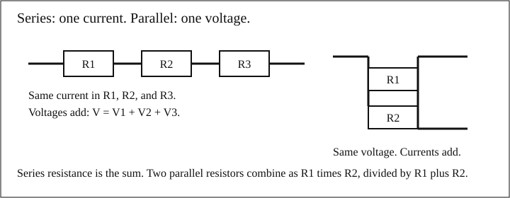
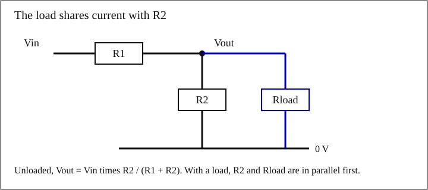
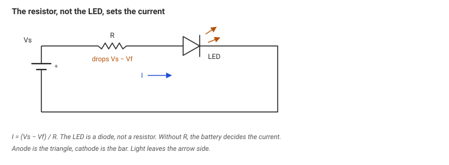

The short answer: the LED that dies had no resistor, so the battery decided the current. The LED that lives had a resistor that set the current near the datasheet value. The rest of this module is the set of tools behind that sentence: [charge]({{ '/glossary/#charge' | relative_url }}), [current]({{ '/glossary/#current' | relative_url }}), [voltage]({{ '/glossary/#voltage' | relative_url }}), [resistance]({{ '/glossary/#resistance' | relative_url }}), [power]({{ '/glossary/#power' | relative_url }}), and what a meter actually connects to.

## 1. Charge, current, voltage, resistance

### The idea

Charge is a quantity, in coulombs. Current is how fast charge moves. One ampere is one coulomb passing a point in one second:

$$
I = \frac{Q}{t}
$$

$$I$$ is current in amperes (A), $$Q$$ is charge in coulombs (C), and $$t$$ is time in seconds (s).

Voltage is a difference between two points, not an amount sitting on one wire. A 9 V battery promises 9 V *between its two terminals* when you are not asking it for much current. It does not promise 9 V from either terminal to the floor.

Resistance is how hard a part pushes back against current. A resistor is the part built to do that on purpose.

A water picture helps once, then it gets in the way. Pressure is like voltage, flow is like current, and a narrow pipe is like resistance. The picture fails in three places. Charge does not spill out of an intact wire the way water spills from a hose. Voltage is only a difference, so "how much voltage is in the wire" is not a question with an answer. And a capacitor, in the next module, is not a bucket you can pour out without a closed path.

### A first number

A current of 0.020 A for 10 s moves

$$
Q = I t = 0.020\,\mathrm{A} \times 10\,\mathrm{s} = 0.20\,\mathrm{C}
$$

Twenty milliamperes is a small indicator-LED current. A fifth of a coulomb is still a huge number of electrons, and you do not need that count to design the resistor.

## 2. Ohm's law

[Ohm's law]({{ '/glossary/#ohms-law' | relative_url }}) is the working relation for a resistor:

$$
V = I R
$$

$$V$$ is the voltage *across that resistor* in volts (V), $$I$$ is the current *through it* in amperes (A), and $$R$$ is the resistance in ohms ($$\Omega$$). Rearranged:

$$
I = \frac{V}{R}, \qquad R = \frac{V}{I}
$$

Worked example. Five volts across $$100\,\Omega$$:

$$
I = \frac{5\,\mathrm{V}}{100\,\Omega} = 0.050\,\mathrm{A} = 50\,\mathrm{mA}
$$

The voltage has to be the voltage across the resistor you are using. The battery voltage is that number only if the resistor is the only thing across the battery.

## 3. Power, and the rating printed on the resistor

Power is the rate of energy. For a DC resistor the three forms are the same number:

$$
P = V I = I^{2} R = \frac{V^{2}}{R}
$$

$$P$$ is in watts (W).

Same example, three ways:

$$
P = 5 \times 0.050 = 0.250\,\mathrm{W}
$$

$$
P = (0.050)^{2} \times 100 = 0.250\,\mathrm{W}
$$

$$
P = \frac{5^{2}}{100} = 0.250\,\mathrm{W}
$$

A resistor turns that power into heat. The rating is how much heat it was built to shed. Common ratings are 1/8 W (0.125 W), 1/4 W (0.25 W), 1/2 W (0.5 W), 1 W, and 2 W. This 0.250 W example sits exactly on a 1/4 W part. A 1/2 W part has margin. Running at half the rating, so the part stays cooler, is a common practice. It is not a law.



## 4. Series and parallel

[Series]({{ '/glossary/#series-circuit' | relative_url }}): one path, so one current. Resistances add.

$$
R_{\mathrm{series}} = R_1 + R_2 + R_3
$$

[Parallel]({{ '/glossary/#parallel-circuit' | relative_url }}): the same voltage across each part. Two resistors combine as

$$
R_{\mathrm{parallel}} = \frac{R_1 R_2}{R_1 + R_2}
$$

Three or more: add the reciprocals, then invert.

$$
\frac{1}{R} = \frac{1}{R_1} + \frac{1}{R_2} + \frac{1}{R_3}
$$

{: .figure}

*Series shares the current and adds the voltages. Parallel shares the voltage and adds the currents.*

Worked series. $$100\,\Omega$$, $$220\,\Omega$$, and $$180\,\Omega$$ on a 12 V source.

$$
R = 100 + 220 + 180 = 500\,\Omega
$$

$$
I = \frac{12}{500} = 0.024\,\mathrm{A} = 24\,\mathrm{mA}
$$

Drops, each one $$I R$$:

$$
V_{100} = 0.024 \times 100 = 2.40\,\mathrm{V}
$$

$$
V_{220} = 0.024 \times 220 = 5.28\,\mathrm{V}
$$

$$
V_{180} = 0.024 \times 180 = 4.32\,\mathrm{V}
$$

$$
2.40 + 5.28 + 4.32 = 12.00\,\mathrm{V}
$$

That last line is [KVL]({{ '/glossary/#kvl' | relative_url }}), Kirchhoff's voltage law: around a closed loop the rises and the drops sum to zero.

Worked parallel. $$100\,\Omega$$ in parallel with $$220\,\Omega$$:

$$
R = \frac{100 \times 220}{100 + 220} = \frac{22000}{320} = 68.75\,\Omega
$$

The combination is smaller than either resistor. A second path makes current easier, not harder.

## 5. Two nodes, KCL and KVL

[KCL]({{ '/glossary/#kcl' | relative_url }}), Kirchhoff's current law: at a node, current in equals current out. Charge does not accumulate at a junction of wires.

This circuit has two unknown voltages. $$R_1$$ connects the source to node A. $$R_3$$ connects A to 0 V. $$R_2$$ connects A to node B. $$R_4$$ connects B to 0 V.

Use the widget's starting values: $$V_{\mathrm{in}} = 12\,\mathrm{V}$$, $$R_1 = 1\,\mathrm{k}\Omega$$, and $$R_2 = R_3 = R_4 = 2\,\mathrm{k}\Omega$$.

At B, $$R_2$$ and $$R_4$$ are equal, so $$V_B = V_A / 2$$.

At A, current through $$R_1$$ equals current through $$R_3$$ plus current through $$R_2$$:

$$
\frac{12 - V_A}{1000} = \frac{V_A}{2000} + \frac{V_A / 2}{2000}
$$

The right-hand side is $$V_A / 2000 + V_A / 4000$$. Multiply through by 4000:

$$
4(12 - V_A) = 2 V_A + V_A
$$

$$
48 - 4 V_A = 3 V_A
$$

$$
V_A = \frac{48}{7} = 6.857\,\mathrm{V}, \qquad V_B = 3.429\,\mathrm{V}
$$

Currents:

$$
I_1 = \frac{12 - 6.857}{1000} = 5.143\,\mathrm{mA}
$$

$$
I_3 = \frac{6.857}{2000} = 3.429\,\mathrm{mA}
$$

$$
I_2 = \frac{6.857 - 3.429}{2000} = 1.714\,\mathrm{mA}
$$

$$
I_4 = \frac{3.429}{2000} = 1.714\,\mathrm{mA}
$$

Check KCL at A: $$5.143 = 3.429 + 1.714$$. Check KCL at B: $$I_2 = I_4$$. Check KVL from the source through $$R_1$$ to A: $$5.143\,\mathrm{mA} \times 1\,\mathrm{k}\Omega + 6.857\,\mathrm{V} = 12.00\,\mathrm{V}$$.




The two-node solve above used a shortcut, because $$R_2$$ and $$R_4$$ were equal. The general step is the same idea with conductances $$G = 1/R$$.

$$
(G_1 + G_2 + G_3) V_A - G_2 V_B = G_1 V_{\mathrm{in}}
$$

$$
G_2 V_A - (G_2 + G_4) V_B = 0
$$

The widget solves that pair. You do not need the matrix for a series string or a single divider. You need it when a node has three or more branches and you cannot see the answer by splitting one current in half.



## 6. Voltage dividers, and the load that ruins them

A [voltage divider]({{ '/glossary/#voltage-divider' | relative_url }}) is two resistors in series. The output is the bottom one, **if nothing else draws current**:

$$
V_{\mathrm{out}} = V_{\mathrm{in}} \frac{R_2}{R_1 + R_2}
$$

Worked, unloaded. $$V_{\mathrm{in}} = 5\,\mathrm{V}$$, $$R_1 = R_2 = 10\,\mathrm{k}\Omega$$.

$$
V_{\mathrm{out}} = 5 \times \frac{10000}{20000} = 2.500\,\mathrm{V}
$$

Now hang $$10\,\mathrm{k}\Omega$$ on the output. That load is in parallel with $$R_2$$:

$$
R_2 \parallel R_L = \frac{10000 \times 10000}{20000} = 5.00\,\mathrm{k}\Omega
$$

$$
V_{\mathrm{out}} = 5 \times \frac{5000}{10000 + 5000} = 1.667\,\mathrm{V}
$$

The unloaded formula was wrong by $$2.500 - 1.667 = 0.833\,\mathrm{V}$$, a third of the voltage you wanted. The rule of thumb: if the load is not much larger than $$R_2$$, put the load in the formula.

{: .figure}

*Rload is in parallel with R2. Ignore it and the unloaded formula overstates the voltage.*

A digital multimeter on a DC voltage range is often about $$10\,\mathrm{M}\Omega$$ from lead to lead. That number is typical of a class of meter. Read the manual for the one in your hand. Same divider, meter as the load:

$$
R_2 \parallel 10\,\mathrm{M}\Omega = \frac{10\,\mathrm{k}\Omega \times 10\,\mathrm{M}\Omega}{10\,\mathrm{k}\Omega + 10\,\mathrm{M}\Omega} = 9.990\,\mathrm{k}\Omega
$$

$$
V_{\mathrm{out}} = 5 \times \frac{10\,\mathrm{M}\Omega}{10\,\mathrm{k}\Omega + 2 \times 10\,\mathrm{M}\Omega} = 2.499\,\mathrm{V}
$$

The sag is $$1.25\,\mathrm{mV}$$. A 10 MΩ meter does not bother a 10 kΩ divider. It would bother a divider made of $$10\,\mathrm{M}\Omega$$ resistors.

The resistance the load "sees" looking back into the divider, with the source replaced by a short, is $$R_1 \parallel R_2$$. Here that is $$5\,\mathrm{k}\Omega$$. A stiff divider uses small resistors, draws more idle current, and sags less. A gentle divider does the opposite.



## 7. Why one LED lives and the other dies

An LED is a diode. Once it conducts, the voltage across it stays near a [forward voltage]({{ '/glossary/#forward-voltage' | relative_url }}) $$V_f$$ from the datasheet. $$V_f$$ depends on current and on the LED. It is not $$I R$$.

Put a resistor in series. The resistor gets whatever voltage the LED does not:

$$
R = \frac{V_s - V_f}{I_f}, \qquad P = (V_s - V_f) I_f
$$

$$V_s$$ is the supply, $$I_f$$ is the current you want, and $$P$$ is heat in the resistor.

{: .figure}

*One loop. The resistor sets the current. The LED does not.*

Worked example, labeled as a round datasheet-style pair for a small red indicator, not a measurement of a particular lamp. Use the LED you actually have when you build one. $$V_s = 9\,\mathrm{V}$$, $$V_f = 2.0\,\mathrm{V}$$, $$I_f = 20\,\mathrm{mA}$$.

$$
R = \frac{9.0 - 2.0}{0.020} = 350\,\Omega
$$

$$
P = 7.0 \times 0.020 = 0.140\,\mathrm{W}
$$

You cannot buy $$350\,\Omega$$ in the coarse series. E24 (the 5% series) steps 330, 360. E12 (the 10% series) steps 330, 390. The value to fit is the next one **at or above** $$350\,\Omega$$, so the current stays at or under 20 mA.

E24 next up is $$360\,\Omega$$:

$$
I = \frac{7.0}{360} = 19.4\,\mathrm{mA}, \qquad P = 7.0 \times 0.0194 = 0.136\,\mathrm{W}
$$

A 1/8 W resistor is rated 0.125 W, which is under 0.136 W. Use at least 1/4 W.

E12's nearest value is $$330\,\Omega$$, which is *under* the ideal resistance:

$$
I = \frac{7.0}{330} = 21.2\,\mathrm{mA}
$$

That is already past the 20 mA you asked for. Nearest is the wrong rule when too much current is what kills the LED. Next value up is the rule.

The LED with no resistor is the one that dies. The LED is not a resistor, so Ohm's law does not set its current. A teaching model of a tired 9 V battery, internal resistance $$2\,\Omega$$, not a measurement, gives

$$
I \approx \frac{9 - 2}{2} = 3.5\,\mathrm{A}
$$

A small indicator cannot survive amperes. The same battery, same LED, plus $$360\,\Omega$$, gives 19 mA. The resistor is the whole difference.




E12 and E24 are standard ratio series. Within a decade the values are spaced by a roughly constant percentage, which is why 330, 360, and 390 show up instead of 340 or 350. E12 is the 10% series. E24 is the 5% series. A 5% band on $$360\,\Omega$$ is $$\pm 18\,\Omega$$, so a real part can sit from about $$342\,\Omega$$ to $$378\,\Omega$$. At $$342\,\Omega$$ the example LED would take $$7.0 / 342 = 20.5\,\mathrm{mA}$$. If the datasheet maximum is 20 mA and you are unwilling to cross it, step up again or use a 1% value. The widget's "next up" is the starting pick, not the last word once tolerance is in the picture.



## 8. A real source sags

An ideal source holds its voltage at any current. A battery does not. It has [internal resistance]({{ '/glossary/#internal-resistance' | relative_url }}). The load and that resistance form a divider:

$$
V_{\mathrm{load}} = V_s \frac{R_L}{R_{\mathrm{int}} + R_L}
$$

Teaching model, not a measured cell: $$V_s = 9\,\mathrm{V}$$, $$R_{\mathrm{int}} = 1\,\Omega$$, $$R_L = 8\,\Omega$$.

$$
V_{\mathrm{load}} = 9 \times \frac{8}{9} = 8.0\,\mathrm{V}, \qquad I = \frac{9}{9} = 1.0\,\mathrm{A}
$$

Heat inside the source: $$I^{2} R_{\mathrm{int}} = 1.0\,\mathrm{W}$$. The terminal voltage fell by a volt because the source spent a volt on itself. A shared battery that also feeds something which suddenly draws current will dip for everything else on that battery. The dip is this divider, not a mystery.

## 9. Ground is a label for 0 V

[Ground]({{ '/glossary/#ground' | relative_url }}) is the node you choose to call 0 V. Every other voltage on the page is a difference from that node, or between two named nodes. Two nets both called ground are the same node only where a wire or a pour actually joins them. A meter between two points does not care what you named them. It reads the difference.

## 10. What the meter is doing

Three measurements, three different circuits.

**Voltage.** Leads across the part, in parallel with it. A DC voltage range on a typical handheld meter is about $$10\,\mathrm{M}\Omega$$. That is the load in the divider example above. You are not supposed to break the circuit.

**Current.** Break the wire and put the meter in the gap, in series, so the current you want is the current through the meter. The meter is a small resistance (a shunt) plus a fuse. If you put the current jacks *across a source*, the meter is nearly a short. The current is then limited by the source and the fuse, not by the circuit you meant to measure. The fuse opens. That is the failure. Do it once and you will buy fuses.

**Resistance.** The circuit is unpowered. The meter applies a small current of its own and reads the voltage that current produces. On a live board you are not measuring the resistor. You may also damage the meter.

The LED lesson and the meter lesson are the same lesson. The instrument has to be the part you think it is. A current meter across a battery is not a current measurement. An LED across a battery is not a defined current either.

## Check yourself


















- Current is charge per second. Voltage is a difference between two points. Ohm's law, $$V = I R$$, ties those to resistance.
- Resistor heat is $$P = V I = I^{2} R = V^{2} / R$$. The rating is the heat the part can shed. Past the rating, it is the wrong part.
- Series resistors add. Two in parallel combine as the product over the sum. KVL: loop voltages sum to zero. KCL: node currents sum to zero.
- A divider formula without the load is true only when the load is much larger than the bottom resistor. A 10 MΩ meter barely loads a 10 kΩ divider. A 10 kΩ load does.
- An LED needs a series resistor $$R = (V_s - V_f) / I_f$$. Pick the next standard value at or above that resistance, and check the resistor's power. No resistor means the source sets the current.
- A real source has internal resistance, so the terminal voltage falls as the load current rises. Ground is the node you call 0 V.
- Measure voltage in parallel, current in series, and resistance only on an unpowered circuit. Current jacks across a source blow the fuse.



## Hands-on exercise

This one is yours. It is not a result from a flight, and it is not the recording. The recording is a walk-through of the same three checks. This is the version you do with a current-limited supply and a meter.

**Safety.** Use a bench supply with the current limit set near 50 mA before you connect the divider. Do not use the meter's current jacks anywhere in this exercise. If a reading is nonsense, turn the output off before you move leads.

**Divider, then the load.** Build $$R_1 = R_2 = 10\,\mathrm{k}\Omega$$ from 5.0 V to 0 V. Before you turn the supply on, write the unloaded prediction: 2.50 V. Measure at the middle node with the meter on a DC voltage range. A 10 MΩ meter should read about 2.499 V. The 1 mV is smaller than most meters will show, so 2.50 V on the display is the expected outcome.

Then add $$R_L = 10\,\mathrm{k}\Omega$$ from the middle node to 0 V, with the supply still at 5.0 V. The prediction is 1.667 V. Measure it. If you are more than a few percent off, one of the three resistors is not 10 kΩ, or the supply is not 5.0 V. Write the three resistor readings (meter on resistance, supply off) in the table.

| Step | What you predicted | What the meter said |
| --- | --- | --- |
| Unloaded middle node | 2.50 V |  |
| Middle node with 10 kΩ load | 1.667 V |  |
| Each resistor, supply off | 10 kΩ |  |

**LED, only with the resistor.** Read $$V_f$$ and the recommended current from the LED's datasheet. Do not reuse the 2.0 V and 20 mA example unless that is what the datasheet says. Compute $$R$$, pick the next E24 value up, and check $$P$$ against the resistor in your hand. Current-limit the supply near twice the target current. If you skip the resistor, you are repeating the failure this module started with.

The side-by-side of a 10 MΩ meter and a heavy load, on camera, is the [lab practical](practical-lab.html).

## Design challenges

Each widget ends with a design card. The numbers below are the targets. The check, and a reference preset, live in the widget.

- [Power playground]({{ '/ee/01-circuit-fundamentals/widgets/demo.html?w=ohms-power' | relative_url }}#dc-ohms-power). Bleed a 12 V rail at about 10 mA and keep the resistor at or under 0.25 W.
- [Two nodes]({{ '/ee/01-circuit-fundamentals/widgets/demo.html?w=kvl-kcl' | relative_url }}#dc-kvl-kcl). Set node A to 6 V and node B to 3 V from 12 V, with every branch at or under 1 mA.
- [Loaded divider]({{ '/ee/01-circuit-fundamentals/widgets/demo.html?w=voltage-divider' | relative_url }}#dc-voltage-divider). Make 3.3 V from 12.6 V and keep the sag under 1% with a 100 kΩ load.
- [LED resistor]({{ '/ee/01-circuit-fundamentals/widgets/demo.html?w=led-limit' | relative_url }}#dc-led-limit). From 9 V into a 2.0 V LED at 10 mA, pick the next E24 value up and stay under 1/8 W.
