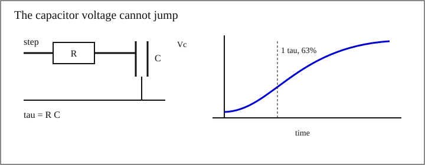
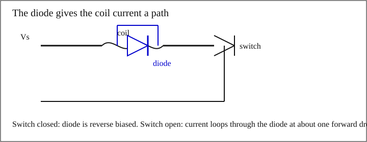
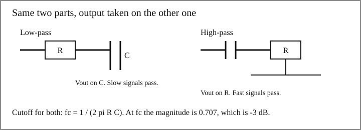

A resistor's current changes the moment the voltage does. A [capacitor]({{ '/glossary/#capacitor' | relative_url }}) and an [inductor]({{ '/glossary/#inductor' | relative_url }}) do not. The capacitor's voltage cannot jump, which is why a supply rail sags over microseconds instead of disappearing in an instant, and why a reset pin can wait a millisecond on purpose. The inductor's current cannot jump, which is why opening a switch on a coil produces a voltage spike. This module stays at that idea. The ways real parts miss the ideal formulas are module 09.

## What they store

A capacitor stores energy in an electric field. An inductor stores energy in a magnetic field.

$$
E_C = \frac{1}{2} C V^{2}, \qquad E_L = \frac{1}{2} L I^{2}
$$

$$E$$ is energy in joules (J). $$C$$ is capacitance in farads (F). $$V$$ is the capacitor voltage in volts (V). $$L$$ is inductance in henries (H). $$I$$ is the inductor current in amperes (A).

Worked. A $$10\,\mu\mathrm{F}$$ capacitor at 5 V:

$$
E_C = \frac{1}{2} \times 10 \times 10^{-6} \times 5^{2} = 125 \times 10^{-6}\,\mathrm{J} = 125\,\mu\mathrm{J}
$$

A $$1\,\mathrm{mH}$$ inductor at 0.20 A:

$$
E_L = \frac{1}{2} \times 0.001 \times (0.20)^{2} = 20 \times 10^{-6}\,\mathrm{J} = 20\,\mu\mathrm{J}
$$

Those are small next to a battery, and they are large next to a logic edge. The capacitor can cover a short gap in the supply. The inductor can produce a large voltage if you try to stop its current quickly, because that stored energy has to go somewhere.

## The two laws

Ideal capacitor:

$$
I = C \frac{dV}{dt}
$$

Current is capacitance times how fast the voltage is changing. A constant voltage means zero current, after the capacitor has charged. A fast edge means a large current.

Ideal inductor:

$$
V = L \frac{dI}{dt}
$$

Voltage is inductance times how fast the current is changing. A constant current means zero voltage across an ideal inductor. A current that is forced to stop means a large voltage.

Worked capacitor. $$C = 10\,\mu\mathrm{F}$$, and you want the voltage to fall no more than $$0.10\,\mathrm{V}$$ while a load takes $$100\,\mathrm{mA}$$.

$$
\frac{dV}{dt} = \frac{I}{C} = \frac{0.100}{10 \times 10^{-6}} = 10000\,\mathrm{V/s} = 10\,\mathrm{V/ms}
$$

Time to fall 0.10 V at that slope:

$$
\Delta t = \frac{C\,\Delta V}{I} = \frac{10 \times 10^{-6} \times 0.10}{0.100} = 10\,\mu\mathrm{s}
$$

That is the hold-up of an ideal capacitor at a constant current. A real capacitor has series resistance, and a regulator starts to correct the dip. Both of those shorten or reshape this window. They are module 09. The $$10\,\mu\mathrm{s}$$ figure is the ideal arithmetic, labeled as such.

A load that steps on, a motor starting or a radio beginning to transmit, is one place this shows up. The capacitor is the part that covers the first moments, before anything slower can react.

## RC charge and discharge

A resistor and a capacitor in series have one [time constant]({{ '/glossary/#time-constant' | relative_url }}):

$$
\tau = R C
$$

$$R$$ in ohms and $$C$$ in farads give $$\tau$$ in seconds. Charging from 0 toward a final voltage $$V$$:

$$
v(t) = V \left(1 - e^{-t / \tau}\right)
$$

At $$t = \tau$$, $$e^{-1} = 0.368$$, so the voltage has covered $$1 - 0.368 = 0.632$$ of the step. Call that 63%. At $$t = 5\tau$$, $$e^{-5} = 0.00674$$, so 99.3% of the step is done. Discharging from $$V$$ toward 0 is $$v(t) = V e^{-t / \tau}$$: 37% left after one $$\tau$$, under 1% left after five.

<figure>

<figcaption>The voltage on the capacitor approaches the step. It does not jump to it. One time constant is 63% of the way. Five is close enough for most resets and debounces.</figcaption>
</figure>

Worked debounce, or a crude reset delay. $$R = 10\,\mathrm{k}\Omega$$, $$C = 100\,\mathrm{nF}$$.

$$
\tau = 10000 \times 100 \times 10^{-9} = 1.00 \times 10^{-3}\,\mathrm{s} = 1.00\,\mathrm{ms}
$$

If the pin lets go when the capacitor reaches 63% of the supply, the wait is one time constant, 1.00 ms. If the threshold is half the supply, which is an assumption about a logic input and not a number from a particular chip:

$$
0.5 = 1 - e^{-t / \tau}
$$

$$
e^{-t / \tau} = 0.5
$$

$$
t = \tau \ln 2 = 0.693\,\mathrm{ms}
$$

An RL pair has the same shape for current, with

$$
\tau = \frac{L}{R}
$$

Worked. $$L = 1\,\mathrm{mH}$$, $$R = 10\,\Omega$$, source $$5\,\mathrm{V}$$. The final current is $$5 / 10 = 0.50\,\mathrm{A}$$. The time constant is $$0.001 / 10 = 0.10\,\mathrm{ms}$$. At one time constant the current is $$0.50 \times 0.632 = 0.316\,\mathrm{A}$$.

## Kickback, and the diode that catches it

An inductor will make whatever voltage it needs in order to keep its current continuous. Opening a switch tries to make the current zero. The inductor answers with $$V = L\,\Delta I / \Delta t$$.

Teaching model, not a measured edge: $$L = 1\,\mathrm{mH}$$, current $$0.20\,\mathrm{A}$$, and the switch forces that current to stop in $$1\,\mu\mathrm{s}$$.

$$
V = \frac{0.001 \times 0.20}{1 \times 10^{-6}} = 200\,\mathrm{V}
$$

The supply may only be 5 V. The switch still sees the 200 V model, because the inductor, not the supply, is setting the voltage during that microsecond. A real transistor breaks down somewhere. This page does not invent that breakdown voltage.

A [flyback diode]({{ '/glossary/#flyback-diode' | relative_url }}) gives the current another path. Across the coil, cathode toward the supply, the diode is off while the switch is closed. When the switch opens, the current runs through the diode. The voltage on the coil is then about one diode drop, not hundreds of volts.

Use $$0.7\,\mathrm{V}$$ as a round silicon drop. It is not a datasheet reading at this current. The current falls to zero in

$$
t = \frac{L I}{V_f} = \frac{0.001 \times 0.20}{0.7} = 286\,\mu\mathrm{s}
$$

On a 5 V supply the switch node sits near $$5.0 + 0.7 = 5.7\,\mathrm{V}$$ while that happens, instead of the 200 V model.

<figure>

<figcaption>The diode is backwards while the switch is on. When the switch opens, coil current circulates through the diode and the switch node only rises by about one forward drop above the supply.</figcaption>
</figure>

## Reactance: ohms that depend on frequency

A sine wave at frequency $$f$$ hertz sees a [reactance]({{ '/glossary/#reactance' | relative_url }}), in ohms:

$$
X_C = \frac{1}{2 \pi f C}, \qquad X_L = 2 \pi f L
$$

A capacitor looks smaller as frequency goes up. An inductor looks larger. A resistor does not care about frequency, in this ideal picture.

Worked at $$1\,\mathrm{kHz}$$. $$C = 100\,\mathrm{nF}$$:

$$
X_C = \frac{1}{2 \pi \times 1000 \times 100 \times 10^{-9}} = 1592\,\Omega
$$

$$L = 10\,\mathrm{mH}$$:

$$
X_L = 2 \pi \times 1000 \times 0.010 = 62.8\,\Omega
$$

## RC low-pass and high-pass

A series resistor and a capacitor to ground, output taken on the capacitor, is a [low-pass filter]({{ '/glossary/#low-pass' | relative_url }}). Swap the parts, output on the resistor, and it is a [high-pass filter]({{ '/glossary/#high-pass' | relative_url }}). Both have the same [cutoff]({{ '/glossary/#cutoff' | relative_url }}):

$$
f_c = \frac{1}{2 \pi R C}
$$

At $$f_c$$ the magnitude is $$1/\sqrt{2} = 0.707$$, which is $$-3.01\,\mathrm{dB}$$. A decade above $$f_c$$, a low-pass is down about 20 dB. The phase of the low-pass at $$f_c$$ is $$-45^\circ$$.

<figure>

<figcaption>Same R and C. The low-pass takes its output on the capacitor. The high-pass takes its output on the resistor.</figcaption>
</figure>

Worked. $$R = 1.6\,\mathrm{k}\Omega$$, $$C = 100\,\mathrm{nF}$$.

$$
R C = 1600 \times 100 \times 10^{-9} = 1.60 \times 10^{-4}\,\mathrm{s}
$$

$$
f_c = \frac{1}{2 \pi \times 1.60 \times 10^{-4}} = 995\,\mathrm{Hz}
$$

At ten times that, $$9.95\,\mathrm{kHz}$$, the low-pass magnitude is

$$
|H| = \frac{1}{\sqrt{1 + 10^{2}}} = 0.0995
$$

$$
20 \log_{10}(0.0995) = -20.0\,\mathrm{dB}
$$

The high-pass does the mirror image: about $$-20\,\mathrm{dB}$$ at a tenth of $$f_c$$, and it passes the fast tone.

## Combining capacitors and inductors

Capacitors in parallel add, because each one stores charge at the same voltage. Capacitors in series combine like parallel resistors. Inductors do the opposite: series inductors add, parallel inductors combine like parallel resistors.

Two $$10\,\mu\mathrm{F}$$ in parallel:

$$
C = 10 + 10 = 20\,\mu\mathrm{F}
$$

The same two in series:

$$
C = \frac{10 \times 10}{10 + 10} = 5.0\,\mu\mathrm{F}
$$

Two $$10\,\mathrm{mH}$$ in series are $$20\,\mathrm{mH}$$. In parallel they are $$5.0\,\mathrm{mH}$$.


Put an inductor and a capacitor together and there is a frequency where their reactances match:

$$
2 \pi f L = \frac{1}{2 \pi f C}, \qquad f_0 = \frac{1}{2 \pi \sqrt{L C}}
$$

Worked, ideal parts. $$L = 10\,\mu\mathrm{H}$$, $$C = 100\,\mathrm{pF}$$.

$$
L C = 10 \times 10^{-6} \times 100 \times 10^{-12} = 1.00 \times 10^{-15}
$$

$$
f_0 = \frac{1}{2 \pi \sqrt{1.00 \times 10^{-15}}} = 5.03\,\mathrm{MHz}
$$

That equality is [resonance]({{ '/glossary/#resonance' | relative_url }}). It is the start of filters, oscillators, and matching networks. Those belong to the [RF series]({{ '/rf/' | relative_url }}). Nothing in this module asks you to tune one.



## Check yourself



{% include check-yourself.html
   question="R is 4.7 kilohms and C is 220 nanofarads. What is tau, and about how long until the step has settled?"
   answer="tau = 4700 times 220e-9 = 1.03 ms. One time constant is 63% of the step. About five time constants, 5.2 ms, gets you to 99%." %}














- A capacitor stores $$\tfrac{1}{2} C V^{2}$$ and obeys $$I = C\,dV/dt$$. An inductor stores $$\tfrac{1}{2} L I^{2}$$ and obeys $$V = L\,dI/dt$$. Voltage on a capacitor and current in an inductor do not jump.
- $$\tau = RC$$ for a capacitor, and $$\tau = L/R$$ for an inductor. One time constant covers 63% of the step. Five covers about 99%.
- Ideal hold-up is $$\Delta t = C\,\Delta V / I$$. A $$10\,\mu\mathrm{F}$$ part, 0.1 V, and 100 mA is 10 µs, before real-part effects.
- Opening a switch on a coil produces $$L\,\Delta I/\Delta t$$. A flyback diode across the coil clamps that to about one diode drop and lets the current decay in $$L I / V_f$$.
- $$X_C = 1/(2\pi f C)$$ falls with frequency. $$X_L = 2\pi f L$$ rises. A resistor, ideally, does neither.
- An RC low-pass or high-pass cuts off at $$f_c = 1/(2\pi R C)$$, where the gain is 0.707, or $$-3\,\mathrm{dB}$$.
- Parallel capacitors add. Series capacitors, and parallel inductors, combine like parallel resistors. Resonance is an RF topic; the formula is $$1/(2\pi\sqrt{LC})$$.



## Hands-on exercise

Two circuits you can check with a scope, and one you only do at low voltage. None of the spike heights below are measurements. The 200 V figure earlier is a different model. Write down what your scope actually shows.

**Safety.** Current-limit the supply. For the coil, 5 V and under 100 mA. Put the scope probe on ×10 and start on a range that can show tens of volts, so a spike does not surprise the front end. Fit the diode before you go looking for a taller spike. If you do open the switch with no diode, do it once, at this low current, and then put the diode back.

**Time constant.** Series $$10\,\mathrm{k}\Omega$$ and $$100\,\mathrm{nF}$$ to ground. Drive the resistor from a square wave, 0 to 5 V, a few hertz, so each half-period is many time constants. Probe the capacitor. Prediction: $$\tau = 1.00\,\mathrm{ms}$$, so the curve passes 63% of the step (3.2 V if the step is 5 V) at 1.0 ms. Measure the time from the edge to that 63% point. A reading within about 20% is a successful build; the capacitor's tolerance is often that wide, and module 09 is where that tolerance is the subject.

**Cutoff.** Rebuild as a low-pass with $$1.6\,\mathrm{k}\Omega$$ and $$100\,\mathrm{nF}$$. Prediction: $$f_c = 995\,\mathrm{Hz}$$. Sweep a sine wave and find where the output amplitude is 0.707 times the input. That frequency is your measured cutoff. Do not expect the last digit of 995.

**Kickback.** A small 5 V relay coil, or an inductor you know, with a series resistor that keeps the current under 100 mA on a current-limited 5 V supply. Scope the switch node. First with a diode across the coil (cathode to the supply side). The node should sit a diode drop above the supply while the current decays, on the order of 5.7 V if the drop is about 0.7 V. Then, once, with the diode lifted, and only if the switch and the scope range can take it. Record the peak you see. Do not copy 200 V into the table. That number was a 1 mH, 0.2 A, 1 µs model.

| Check | Prediction from this page | What you measured |
| --- | --- | --- |
| RC, time to 63% | 1.0 ms |  |
| Low-pass, −3 dB | 995 Hz |  |
| Switch node with diode | about Vs + one diode drop |  |
| Switch node without diode | write what the scope says |  |

The same three checks, on camera, are the [lab practical](practical-lab.html).
