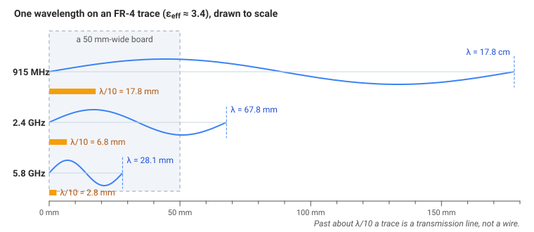
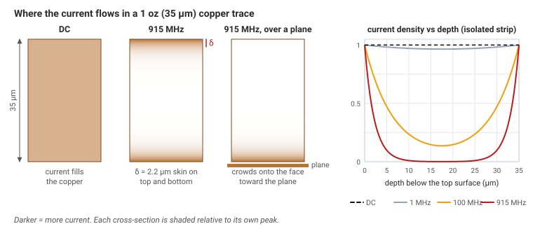
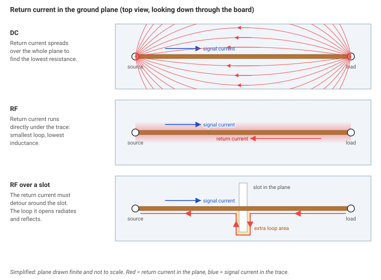
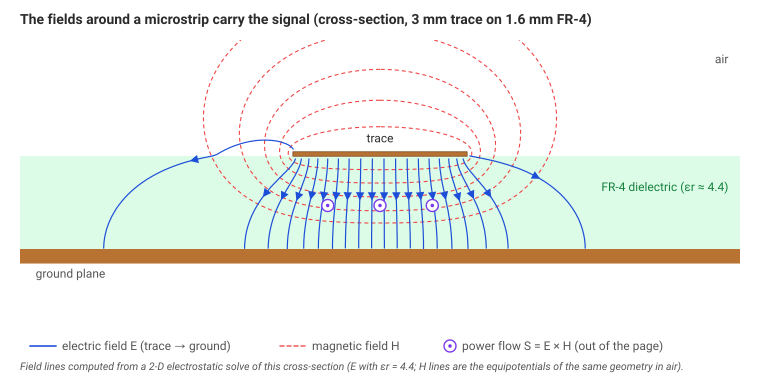

# Module 0: Why RF Is Different

> **What you should already know**
> - What voltage, current and resistance are, and Ohm's law ($$V = IR$$).
> - That a signal can repeat at a *frequency*, measured in hertz (Hz = cycles per second).
> - Scientific prefixes: kilo (10³), mega (10⁶), giga (10⁹), milli (10⁻³), micro (10⁻⁶), nano (10⁻⁹).
>
> No electromagnetics background is needed. Everything else is explained as we go.

**RF** stands for *radio frequency*: signals that repeat roughly a million (MHz) to a hundred billion (GHz) times per second. They carry your Wi-Fi, your phone calls, GPS and a rocket's telemetry.

In a first circuits class you learn three convenient ideas:

1. A wire is a perfect connection, so both ends are at the same voltage.
2. Ground is 0 V everywhere.
3. Current flows *through* the copper, like water through a pipe.

At radio frequencies **all three break down.** This module explains why, using one idea that the rest of the series builds on:

> **Signals are waves, and waves care about distance.**

---

## 1. When does a wire stop being a wire?

### The idea

When you flip a switch, the change doesn't reach the far end of a wire instantly. It travels as a wave, at a large fraction of the speed of light. For a slow signal that doesn't matter. The wave reaches the end long before the signal has changed, so the whole wire effectively sits at one voltage.

A fast signal is different. It can change *while the wave is still on its way down the wire*. Then one end of the wire is at one voltage and the other end is at a different voltage, at the same instant. The wire has stopped being a simple connection. It has become a **transmission line**, a path that guides a traveling wave. Module 1 covers transmission lines.

What decides whether a wire is "short" or "long" is its length compared with the signal's **wavelength**.

### The math

**Wavelength** (λ, "lambda") is the distance a wave travels during one full cycle:

$$\lambda = \frac{v}{f}$$

- $$v$$ is how fast the wave travels, in meters per second (m/s).
- $$f$$ is the frequency in hertz (Hz).

In air or vacuum, $$v$$ is the speed of light, $$c = 3\times10^8$$ m/s. On a circuit board the wave travels partly through the board material, which slows it down by a factor $$\sqrt{\varepsilon_{\text{eff}}}$$:

$$\lambda_{\text{board}} = \frac{c}{f\sqrt{\varepsilon_{\text{eff}}}}$$

- $$\varepsilon_{\text{eff}}$$ ("effective epsilon") is the *effective dielectric constant*, a number that describes how much the material slows the wave. For a trace on common FR-4 board material, $$\varepsilon_{\text{eff}} \approx 3.4$$, so waves move at about $$1/\sqrt{3.4} \approx 54\%$$ of the speed of light.

**Worked example: 915 MHz** (a common rocket-telemetry band)

1. In air: $$\lambda = \dfrac{3\times10^8\ \text{m/s}}{915\times10^6\ \text{Hz}} = 0.328\ \text{m} = 32.8\ \text{cm}$$
2. On FR-4: $$\lambda_{\text{board}} = \dfrac{32.8\ \text{cm}}{\sqrt{3.4}} = \dfrac{32.8}{1.84} = 17.8\ \text{cm}$$

| Frequency | Where you meet it | λ in air | λ on an FR-4 trace | λ/10 on FR-4 |
|---|---|---|---|---|
| 60 Hz | wall power | 5 000 km | — | — |
| 915 MHz | rocket telemetry, LoRa | 32.8 cm | 17.8 cm | 1.8 cm |
| 2.4 GHz | Wi-Fi, Bluetooth | 12.5 cm | 6.8 cm | 6.8 mm |
| 5.8 GHz | FPV drone video | 5.2 cm | 2.8 cm | 2.8 mm |

{: .figure}

*One wavelength on an FR-4 trace, to scale. At 915 MHz λ/10 is 17.8 mm; at 2.4 GHz it is 6.8 mm, a small fraction of a 50 mm board.*

### The rule of thumb

> **If a trace is longer than about λ/10, treat it as a transmission line, not a wire.**

At 2.4 GHz that's only **6.8 mm**, shorter than most traces on a real board. At RF, almost every connection is a transmission line.

Try it in the **wavelength explorer**: pick a frequency and a board material and see λ, λ/10 and λ/4 drawn to scale next to a trace.



> **Go deeper: why λ/10?** Over one wavelength a wave goes through a full 360° cycle. Over λ/10 it goes through 36°, so the two ends of the trace are already noticeably out of step. Kirchhoff's circuit laws assume the voltage is the same all along a wire at every instant. That's the *lumped* model. Past about λ/10 that assumption gets too inaccurate and you need the *distributed* model, where voltage and current vary along the line (Module 1). λ/10 isn't a law of physics. It's a convenient threshold, and some designers use λ/20 to be safe.

---

## 2. Skin effect: RF current lives on the surface

### The idea

At DC (steady current), current spreads evenly through the whole thickness of a copper wire. At high frequency it doesn't. A changing current creates a changing magnetic field *inside* the conductor. That field pushes back against current in the center of the wire and crowds it toward the outer surface. The higher the frequency, the thinner the layer that carries the current.

That's why RF loss depends so much on the *surface* of the copper, meaning its roughness and plating, and only a little on how thick the copper is.

{: .figure}

*Where the current flows in a 1 oz (35 µm) trace. At DC it fills the copper. At 915 MHz it lives in a skin about 2.2 µm deep; over a ground plane it crowds onto the face toward the plane.*

### The math

**Skin depth** (δ, "delta") is the depth at which the current has fallen to about 37% (that's $$1/e$$) of its value at the surface:

$$\delta = \sqrt{\frac{2\rho}{\omega\mu}}$$

- $$\rho$$ is the resistivity of the metal. For copper it's $$1.68\times10^{-8}\ \Omega\cdot\text{m}$$.
- $$\omega = 2\pi f$$ is the *angular frequency* in radians per second.
- $$\mu$$ is the magnetic permeability. For copper it's $$\mu_0 = 4\pi\times10^{-7}$$ H/m.

**Worked example: copper at 915 MHz**

1. $$\omega = 2\pi \times 915\times10^6 = 5.75\times10^9$$ rad/s
2. $$\omega\mu = 5.75\times10^9 \times 1.257\times10^{-6} = 7.23\times10^3$$
3. $$2\rho/(\omega\mu) = 3.36\times10^{-8} / 7.23\times10^3 = 4.65\times10^{-12}\ \text{m}^2$$
4. $$\delta = \sqrt{4.65\times10^{-12}} = 2.2\times10^{-6}\ \text{m} = 2.2\ \mu\text{m}$$

| Frequency | Skin depth in copper |
|---|---|
| 60 Hz | 8.4 mm |
| 1 MHz | 65 µm |
| 915 MHz | 2.2 µm |
| 2.4 GHz | 1.3 µm |

A standard "1 oz" PCB trace is 35 µm thick, so at 915 MHz nearly all the current flows in the top and bottom ~2 µm. That's about the same size as the bumps on the copper's surface, which is why rough copper adds loss (Module 3).

Sweep it yourself in the **skin-depth visualizer**, from 1 kHz to 6 GHz:



---

## 3. Return current takes the path of least *inductance*

### The idea

Current always flows in a loop: out along the signal trace and back along a **return path**, usually the ground plane underneath.

- At **DC**, the return current spreads across the ground plane to find the lowest **resistance**.
- At **RF**, it follows the lowest **inductance**. Inductance is the opposition to a *changing* current, and it grows with the area of the loop the current encloses. The smallest loop is the one where the return current runs **directly underneath the signal trace**.

So at RF the return current hugs the bottom of the trace, mirror-image style.

{: .figure}

*The return current in the plane under a trace. At DC it spreads out; at RF it follows the trace; a slot forces a detour and opens a loop that radiates.*

### Why it matters

Cut a slot in the ground plane under an RF trace, for example to route another signal through, and the return current can't follow the trace any more. It has to detour around the slot, which opens up a big loop. That causes three problems:

1. The loop **radiates**, turning your trace into an accidental antenna.
2. The trace's impedance jumps at the slot, so part of the signal **reflects** (Module 1).
3. Nearby circuits **pick up** the radiated energy, which is called interference (Module 7).

> **Rule:** never route an RF trace over a gap in its ground plane.

---

## 4. "Ground is not ground"

### The idea

On a schematic, every ground symbol is the same perfect 0 V point. On a real board, ground is copper planes connected by **vias** (small plated holes between layers), and every piece of copper has a little **inductance**. At RF, a little inductance is a lot of impedance.

### The math

An inductor's opposition to AC current is its *reactance*:

$$X_L = 2\pi f L$$

- $$X_L$$ is in ohms (Ω).
- $$L$$ is the inductance in henries (H). A typical PCB via is about 0.5–1 nH (nanohenry, $$10^{-9}$$ H).

**Worked example: a 1 nH ground via at 2.4 GHz**

$$X_L = 2\pi \times 2.4\times10^9\ \text{Hz} \times 1\times10^{-9}\ \text{H} = 15\ \Omega$$

Fifteen ohms isn't a short circuit. Two points on the "same" ground can be at different RF voltages, so a ground plane at RF behaves like a network of small inductors.

> **What designers do:** use **many** ground vias in parallel, because N vias in parallel give roughly 1/N the inductance, and place them close to every RF part's ground pin. Module 4 covers via stitching.

---

## 5. The energy travels in the fields

### The idea

This is the most surprising idea in the module: **a signal's energy doesn't travel inside the copper.** It travels in the **electric field** (between conductors at different voltages) and the **magnetic field** (around conductors carrying current), in the *space* around and between them.

The copper only **guides** the wave, the way rails guide a train. On a PCB, most of those fields sit in the board material (the **dielectric**) between the trace and the ground plane underneath. So:

> The board material carries your signal. Its properties matter as much as the copper does.

{: .figure}

*The fields around a 3 mm trace on 1.6 mm FR-4. E runs from the trace to the plane, mostly through the board; H circles the trace. The power flows along the trace, in the space between the conductors.*

> **Go deeper: the Poynting vector.** The direction and amount of power flowing through space is $$\vec S = \vec E \times \vec H$$, in watts per square meter. Here $$\vec E$$ is the electric field and $$\vec H$$ is the magnetic field. For a trace over a ground plane, $$\vec S$$ points along the trace and is concentrated in the dielectric just beneath it. That's why a material's *dielectric constant* (which sets the speed) and *loss tangent* (which sets how much energy turns into heat) show up in every RF calculation (Module 1).

---

## 6. The RF designer's mental model

1. **Think in waves, not just currents.** Ask where the wave goes and what it runs into.
2. **Every discontinuity reflects.** A bend, a via, a component pad or a connector changes the conditions the wave sees, and part of the wave bounces back.
3. **Everything is an antenna if you're careless.** Any loop or stub around a quarter wavelength long can radiate, and it receives just as well.
4. **The three enemies are reflections, loss and interference.** The rest of this series is about beating them.

---

## Key takeaways

- Compare every length to the **wavelength**. Past about **λ/10**, a trace is a transmission line.
- On FR-4, waves travel at about **half the speed of light**, so wavelengths are about half as long as in air.
- RF current flows in a thin **skin** at the surface, about 2 µm thick at 915 MHz.
- **Return current runs under the trace.** Never break the ground plane beneath an RF line.
- **Ground has impedance** at RF: a 1 nH via is 15 Ω at 2.4 GHz. Use lots of vias.
- **Energy travels in the fields**, mostly in the board material.

## Interactive

Both widgets are embedded in the sections above. Open them full screen here:

- **[Wavelength explorer](widgets/demo.html?w=wavelength-explorer):** choose a frequency and a board material and see λ, λ/10 and λ/4 drawn to scale next to a real trace.
- **[Skin-depth visualizer](widgets/demo.html?w=skin-depth):** sweep from DC to 6 GHz and watch the current crowd to the surface of a trace cross-section.

## Practical

*Placeholder: an isolated example from real flight hardware where a "wire" behaved like an RF line.*

## Check yourself

1. **Recall.** What does "λ/10" compare, and what happens when a trace is longer than it?
2. **Calculate.** What is the wavelength of a 433 MHz signal in air? On an FR-4 trace ($$\varepsilon_{\text{eff}} = 3.4$$)?
3. **Calculate.** What is the reactance of a 1 nH ground via at 5.8 GHz? Is that closer to a short circuit or a resistor?
4. **Explain.** Why does a slot in the ground plane under a trace cause trouble at 2.4 GHz but not at 1 kHz?
5. **Design.** A 915 MHz radio chip sits 25 mm from its antenna connector on an FR-4 board. Should you treat that trace as a transmission line? Show your numbers.

## Design challenges

Each widget ends with a design card. The briefs below give the targets. The live check, a hint, the worked answer and a reference preset are in the widget.

- [Does this trace need to be a 50 Ω line?]({{ '/rf/00-mindset/widgets/demo.html?w=wavelength-explorer' | relative_url }}#dc-wavelength-explorer) ([in the lesson](#1-when-does-a-wire-stop-being-a-wire)). A 2.45 GHz radio on 2-layer FR-4. Which of a 4 mm and a 12 mm trace can stay a plain wire, and how long can an uncontrolled trace be?
- [Pick the copper weight for a 433 MHz board]({{ '/rf/00-mindset/widgets/demo.html?w=skin-depth' | relative_url }}#dc-skin-depth) ([in the lesson](#2-skin-effect-rf-current-lives-on-the-surface)). Choose the cheapest copper that is at least 5 skin depths thick, and decide whether 2 oz copper really halves the RF loss.
