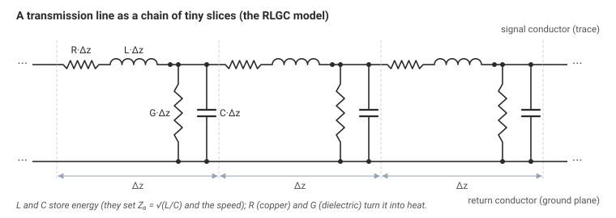
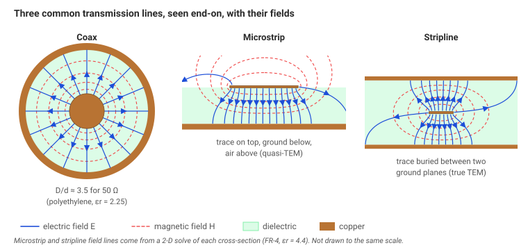
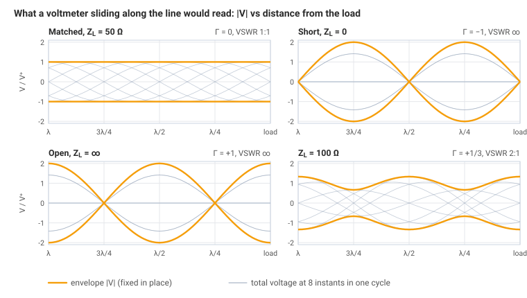
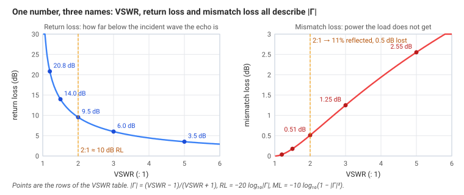
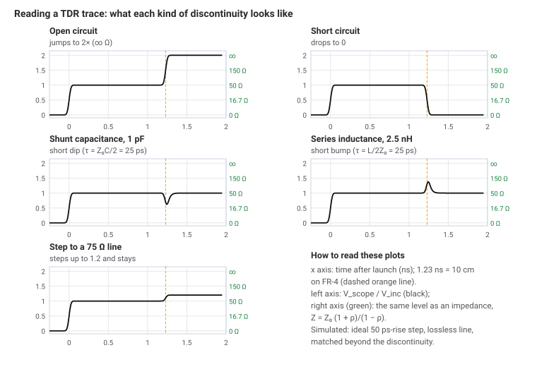
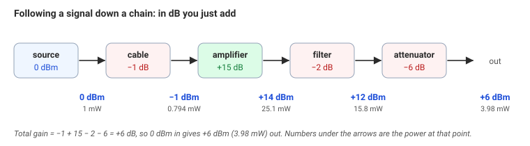
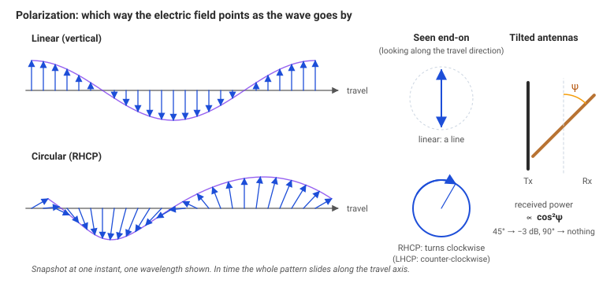
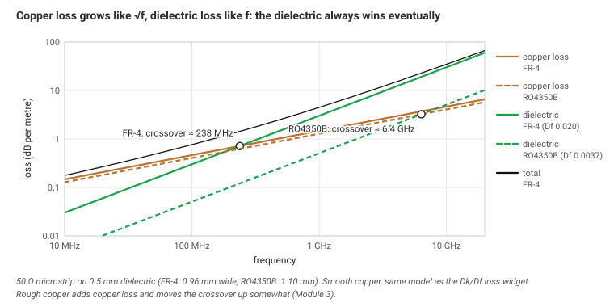

# Module 1: RF Fundamentals

> **What you should already know**
> - Everything in [Module 0](../00-mindset/): wavelength $$\lambda = v/f$$, the λ/10 rule, and the idea that energy travels in the fields around the copper.
> - Ohm's law and what an inductor and a capacitor do. You don't need the formulas memorized; we'll restate them.
> - Logarithms at the level of "$$\log_{10} 100 = 2$$". Section 6 reviews them.
>
> A few formulas use complex numbers ($$a + jb$$). If you haven't met them, read $$j$$ as "this part is 90° out of step", and use the interactive widgets instead of the algebra. You won't miss any of the ideas.

Module 0 ended with one claim: **signals are waves, and waves care about distance.** This module turns that claim into tools you can use. By the end you'll be able to:

- say what a "50 Ω line" really means, and why 50;
- predict how much of a signal bounces back off a mismatched part;
- read the two plots every RF lab produces, a **TDR trace** (reflections in time) and an **S₁₁ sweep** (reflections in frequency);
- do power arithmetic in dB and dBm in your head;
- explain polarization, board-material loss and phase delay.

---

## 1. Transmission lines and characteristic impedance

### The idea

Picture a long trace over a ground plane, and imagine connecting a battery to one end at time zero. A voltage step starts racing down the line. As it moves, it has to do two things to each new bit of line it reaches:

- **charge up the capacitance** between the trace and the ground below it, and
- **build up a magnetic field** around the current, which is the line's inductance.

So a current has to flow to keep the wave moving, even though the far end hasn't been reached yet and might even be an open circuit. The battery can't tell what's at the far end. It only "sees" the ratio of voltage to current that the moving wave needs. That ratio is the line's **characteristic impedance**, $$Z_0$$.

> $$Z_0$$ is not a resistance you could measure with a multimeter. It's the voltage-to-current ratio of a wave traveling along the line. A 50 Ω line still draws 0 A at DC if its far end is open. It only *looks* like 50 Ω to a fast edge or an RF signal, and only until the wave reaches the end.

### The math

Chop the line into tiny slices of length $$\Delta z$$. Each slice has a little series inductance and resistance, and a little shunt capacitance and conductance. This is the **RLGC model**:

- $$L$$: inductance per meter (H/m), from the magnetic field around the current
- $$C$$: capacitance per meter (F/m), between the conductors
- $$R$$: resistance per meter (Ω/m), copper loss (it grows with frequency because of skin effect, Module 0)
- $$G$$: conductance per meter (S/m), leakage through the dielectric (dielectric loss, section 8)

{: .figure}

*The RLGC model: every short slice Δz of line has a little series resistance and inductance and a little shunt conductance and capacitance.*

For a low-loss line ($$R \ll \omega L$$, $$G \ll \omega C$$), which covers almost every RF line you'll meet:

$$Z_0 = \sqrt{\frac{L}{C}} \qquad\qquad v_p = \frac{1}{\sqrt{LC}}$$

- $$Z_0$$ is the characteristic impedance, in ohms (Ω).
- $$v_p$$ is the **phase velocity**, the speed of the wave, in m/s.

**Worked example: a coax cable.** A common 50 Ω coax has $$L = 250$$ nH/m and $$C = 100$$ pF/m.

1. $$Z_0 = \sqrt{250\times10^{-9} / 100\times10^{-12}} = \sqrt{2500} = 50\ \Omega$$
2. $$v_p = 1/\sqrt{250\times10^{-9}\times100\times10^{-12}} = 1/\sqrt{2.5\times10^{-17}} = 2.0\times10^{8}$$ m/s, which is 67% of the speed of light.
3. That speed means the insulation has $$\varepsilon_r = (c/v_p)^2 = 2.25$$, which is solid polyethylene. The numbers hang together.

A wide trace has more capacitance (more area facing the ground) and less inductance (the current spreads out), so **wider trace = lower $$Z_0$$**. Thinner dielectric does the same thing. Higher $$\varepsilon_r$$ raises $$C$$, which also lowers $$Z_0$$.

| Line type | What it looks like | Where you meet it | Typical 50 Ω geometry |
|---|---|---|---|
| **Coax** | center wire inside a tube, full dielectric | cables, SMA connectors | $$D/d \approx 3.5$$ with polyethylene |
| **Microstrip** | trace on top of a board, ground plane below, air above | most RF boards | ≈ 3 mm wide on 1.6 mm FR-4 (3.1 mm for $$\varepsilon_r = 4.4$$); ≈ 0.39 mm on 0.2 mm FR-4 |
| **Stripline** | trace buried between two ground planes | inner layers | narrower than microstrip for the same height |

{: .figure}

*Coax, microstrip and stripline seen end-on. Blue: electric field, from the signal conductor to the return. Red dashed: magnetic field, circling the signal conductor.*

For coax there's a neat exact formula:

$$Z_0 = \frac{60\ \Omega}{\sqrt{\varepsilon_r}}\,\ln\!\frac{D}{d}$$

- $$D$$ is the inside diameter of the outer conductor, $$d$$ the diameter of the center wire, $$\varepsilon_r$$ the insulation's dielectric constant.
- Check: $$\varepsilon_r = 2.25$$, $$D/d = 3.5$$ gives $$\frac{60}{1.5}\ln 3.5 = 40 \times 1.253 = 50.1\ \Omega$$.

For microstrip there's no exact formula, only good approximations (Hammerstad–Wheeler), which the **microstrip calculator** below uses. Module 2 compares the line types in detail.



### Why 50 Ω?

It's a compromise from the early days of coax. For an air-filled coax of fixed outer size:

- **lowest loss** happens at about **77 Ω**;
- **highest power before the air breaks down** happens at about **30 Ω**.

50 Ω sits between the two, close to their geometric mean ($$\sqrt{77\times30} \approx 48$$). It became the standard, so test equipment, connectors, cables and chip datasheets all assume it. **75 Ω** survives where low loss matters more than power, like cable TV and video.

> **Go deeper: the telegrapher's equations.** Apply Kirchhoff's laws to one slice of line and let $$\Delta z \to 0$$. For sinusoidal signals (phasors) you get
> $$\frac{dV}{dz} = -(R + j\omega L)\,I \qquad \frac{dI}{dz} = -(G + j\omega C)\,V$$
> Combining them gives a wave equation, $$d^2V/dz^2 = \gamma^2 V$$, whose solution is two waves, one going each way:
> $$V(z) = V^+ e^{-\gamma z} + V^- e^{+\gamma z}, \qquad \gamma = \alpha + j\beta = \sqrt{(R + j\omega L)(G + j\omega C)}$$
> Here $$\alpha$$ is the loss in nepers per meter (×8.686 for dB/m) and $$\beta = 2\pi/\lambda$$ is the phase constant in rad/m. The ratio of voltage to current *for each wave alone* is
> $$Z_0 = \sqrt{\frac{R + j\omega L}{G + j\omega C}}$$
> which becomes $$\sqrt{L/C}$$ when the losses are small. Everything else in this module is about what happens when the two waves, $$V^+$$ and $$V^-$$, meet.

---

## 2. Reflection and transmission coefficients

### The idea

A wave traveling on a 50 Ω line carries voltage and current in a 50:1 ratio. Now it reaches a load that isn't 50 Ω, say a 100 Ω resistor. The load insists on its own ratio: 100 V for every amp. Both can't be true at the same point, so the line fixes the disagreement by launching a **reflected wave** back toward the source. The incident and reflected waves add up at the load in exactly the way that satisfies the load.

- If the load equals $$Z_0$$, the wave is already "happy". Nothing reflects. This is a **matched** load.
- If the load is different, part of the wave bounces back. The bigger the mismatch, the bigger the echo.

### The math

The **reflection coefficient** Γ ("gamma") is the ratio of reflected to incident voltage at the load:

$$\Gamma = \frac{V^-}{V^+} = \frac{Z_L - Z_0}{Z_L + Z_0}$$

- $$Z_L$$ is the load impedance (Ω). It can be complex: $$Z_L = R + jX$$, where $$X > 0$$ is inductive and $$X < 0$$ is capacitive.
- $$Z_0$$ is the line's characteristic impedance (Ω).
- Γ has no units. Its **magnitude** $$\lvert \Gamma\rvert$$ runs from 0 to 1 and says *how much* reflects. Its **angle** says *with what timing* (phase) the echo comes back.

The **transmission coefficient** τ ("tau") is the voltage that makes it into the load, relative to the incident voltage:

$$\tau = 1 + \Gamma = \frac{2Z_L}{Z_L + Z_0}$$

**Special cases** (memorize these, they come up constantly):

| Load | Γ | What happens |
|---|---|---|
| Matched, $$Z_L = Z_0$$ | 0 | nothing reflects |
| Short, $$Z_L = 0$$ | −1 | everything reflects, upside down (voltage at the load must be 0) |
| Open, $$Z_L = \infty$$ | +1 | everything reflects, same sign (current at the load must be 0) |
| Pure L or C, $$Z_L = jX$$ | $$\lvert \Gamma\rvert  = 1$$ | everything reflects with some phase shift. A reactance can't absorb power |

**Worked example 1: 100 Ω load on a 50 Ω line**

1. $$\Gamma = (100 - 50)/(100 + 50) = 50/150 = 0.333$$
2. $$\tau = 1 + 0.333 = 1.333$$. The load voltage is *bigger* than the incident wave. That isn't free energy:
3. Power is $$V^2/Z$$. Reflected power fraction $$= \lvert \Gamma\rvert ^2 = 0.111$$ (11.1%). Delivered power fraction $$= \lvert \tau\rvert ^2 \cdot Z_0/Z_L = 1.778 \times 0.5 = 0.889$$ (88.9%).
4. Check: $$0.111 + 0.889 = 1$$. Energy is conserved.

**Worked example 2: an antenna that measures $$Z_L = 25 - j25\ \Omega$$**

1. $$\Gamma = \dfrac{(25 - j25) - 50}{(25 - j25) + 50} = \dfrac{-25 - j25}{75 - j25}$$
2. Multiply top and bottom by the conjugate $$75 + j25$$: numerator $$= -1250 - j2500$$, denominator $$= 75^2 + 25^2 = 6250$$.
3. $$\Gamma = -0.2 - j0.4$$, so $$\lvert \Gamma\rvert  = \sqrt{0.04 + 0.16} = 0.447$$ at an angle of −116.6°.
4. Reflected power $$= 0.447^2 = 20\%$$.

> **Power rule for a lossless line:** $$P_{\text{reflected}} = \lvert \Gamma\rvert ^2 P_{\text{incident}}$$ and $$P_{\text{delivered}} = (1 - \lvert \Gamma\rvert ^2)\,P_{\text{incident}}$$.

---

## 3. Standing waves and VSWR

### The idea

When there's a reflection, two waves share the line: the incident wave moving toward the load and the reflected wave moving back. At some points along the line they always arrive in step and add up. At other points they always arrive out of step and partly cancel. The pattern of big and small doesn't move. It's a **standing wave**.

If you slid a voltmeter along the line you'd read a wavy pattern: maxima and minima spaced **λ/2 apart**, with a minimum a quarter wave (λ/4) from each maximum. In the **standing-wave widget** below, watch the blue and red waves move in opposite directions while their sum (black) breathes inside a fixed orange envelope.

- **Matched load:** no reflected wave, flat envelope. Only a traveling wave.
- **Short or open:** the reflection is as big as the incident wave, so the minima go all the way to zero. A short has a voltage zero (node) *at the load*. An open has a voltage maximum at the load and its first node λ/4 back.

{: .figure}

*Standing-wave envelopes (orange) for four loads, with the total voltage at eight instants (grey). The pattern repeats every λ/2.*



### The math

The **voltage standing wave ratio** compares the biggest and smallest voltage on the line:

$$\text{VSWR} = \frac{V_{\max}}{V_{\min}} = \frac{1 + |\Gamma|}{1 - |\Gamma|} \qquad\Longleftrightarrow\qquad |\Gamma| = \frac{\text{VSWR} - 1}{\text{VSWR} + 1}$$

- VSWR runs from 1 (perfect match) to ∞ (total reflection). It's written as a ratio, like "1.5:1".

The same information is usually expressed in decibels (section 6 explains dB):

$$\text{RL} = -20\log_{10}|\Gamma|\ \ \text{dB} \qquad\qquad \text{ML} = -10\log_{10}\!\left(1 - |\Gamma|^2\right)\ \ \text{dB}$$

- **Return loss (RL)** is how far *below* the incident wave the echo is. Bigger is better. A perfect match has infinite return loss.
- **Mismatch loss (ML)** is how much less power the load receives because of the reflection.

| VSWR | $$\lvert \Gamma\rvert$$ | Return loss | Power reflected | Mismatch loss |
|---|---|---|---|---|
| 1.0 : 1 | 0 | ∞ | 0% | 0 dB |
| 1.2 : 1 | 0.091 | 20.8 dB | 0.8% | 0.04 dB |
| 1.5 : 1 | 0.200 | 14.0 dB | 4.0% | 0.18 dB |
| **2.0 : 1** | **0.333** | **9.5 dB** | **11.1%** | **0.51 dB** |
| 3.0 : 1 | 0.500 | 6.0 dB | 25% | 1.25 dB |
| 5.0 : 1 | 0.667 | 3.5 dB | 44% | 2.55 dB |

{: .figure}

*Return loss falls and mismatch loss rises as VSWR grows. At 2:1 the echo is 9.5 dB down and the load loses only 0.51 dB.*

> **Rule of thumb:** VSWR under **2:1** (return loss better than about **10 dB**) is acceptable for most antennas. Only 0.5 dB is lost. Good cables, connectors and filters do much better, typically 1.2:1 (20 dB) or less.

Notice how forgiving this is: a VSWR of 2:1 *sounds* bad, but costs half a dB. The bigger danger of a bad match is often not the lost power. It's the reflected power arriving back at a power amplifier, which can overheat or distort it (Module 3).

> **Watch the sign.** Return loss is a positive number (10 dB). The same measurement plotted as $$S_{11}$$ on a network analyzer is negative (−10 dB), because $$S_{11}$$ is $$20\log_{10}\lvert \Gamma\rvert$$ (Module 2). People say "return loss of −10 dB" all the time. They mean the same thing.

> **Go deeper: where the envelope comes from.** Put the load at $$z = 0$$ and the source at negative $$z$$. The total voltage is $$V(z) = V^+\left(e^{-j\beta z} + \Gamma e^{+j\beta z}\right)$$, so its magnitude is
> $$|V(z)| = |V^+|\,\bigl|1 + \Gamma e^{\,j2\beta z}\bigr|$$
> As $$z$$ changes, the term $$\Gamma e^{j2\beta z}$$ spins around in a circle of radius $$\lvert \Gamma\rvert$$. Adding 1 to it gives a length between $$1 - \lvert \Gamma\rvert$$ and $$1 + \lvert \Gamma\rvert$$, which is where VSWR comes from. It completes one full turn when $$2\beta\,\Delta z = 2\pi$$, so when $$\Delta z = \lambda/2$$. That's why the pattern repeats every half wavelength, and it's the reason a Smith chart (Module 2) goes once around for every λ/2 of line.

---

## 4. Time-domain reflectometry (TDR)

### The idea

TDR is radar for cables and circuit boards. You launch a very fast voltage step into the line and watch the voltage at the launch point. Every time the step meets a change in impedance, part of it reflects and comes back to you. **When** an echo arrives tells you **where** the problem is. **Which way** the trace moves tells you **what** it is.

Reading a TDR trace (the **TDR simulator** further down lets you try each one):

| What you see | What it means | Typical cause |
|---|---|---|
| flat at the 50 Ω level | matched line | a good trace |
| steps **up** and stays | higher impedance from here on | narrower trace, missing ground |
| steps **down** and stays | lower impedance from here on | wider trace, thinner dielectric |
| short **dip** | a little extra capacitance | big pad, via, component |
| short **bump** | a little extra inductance | narrow neck, bond wire, via barrel without ground vias |
| jumps to **2×** (∞ Ω) | open circuit | broken trace, unsoldered connector |
| drops to **0** | short circuit | solder bridge, crushed cable |

{: .figure}

*Simulated TDR traces (50 ps rise time) for a discontinuity 10 cm down an FR-4 line. Dips are capacitive, bumps inductive; a step that stays is a new impedance.*

### The math

The reflected step has height $$\rho\,V_{\text{inc}}$$, where $$\rho$$ is the reflection coefficient (TDR people write ρ, "rho", instead of Γ). The scope shows

$$V_{\text{scope}} = V_{\text{inc}}\,(1 + \rho) \qquad\Longrightarrow\qquad Z = Z_0\,\frac{1 + \rho}{1 - \rho}$$

The echo travels out *and back*, so the distance to the fault is

$$d = \frac{v_p\,t}{2} = \frac{c\,t}{2\sqrt{\varepsilon_{\text{eff}}}}$$

- $$t$$ is the time between launching the step and seeing the echo (s).
- $$v_p$$ is the wave speed on that line (m/s). You must know $$\varepsilon_{\text{eff}}$$ to convert time into distance.

**Worked example: locating a fault.** A TDR on an FR-4 microstrip ($$\varepsilon_{\text{eff}} = 3.4$$) shows the trace jumping to the open level 1.23 ns after launch.

1. $$v_p = 3\times10^8 / \sqrt{3.4} = 3\times10^8/1.844 = 1.63\times10^8$$ m/s
2. $$d = 1.63\times10^8 \times 1.23\times10^{-9} / 2 = 0.100$$ m

The trace is open **10 cm** from the connector.

**How small a thing can TDR see?** About as small as the step's *rise time* allows. The ability to separate two features is roughly $$v_p t_r/2$$. A good 35 ps TDR on FR-4 resolves about $$1.63\times10^8 \times 35\times10^{-12}/2 \approx 3$$ mm. A tiny capacitance shows up as a dip whose time constant is

$$\tau_C = \frac{Z_0 C}{2}\qquad\text{(extra shunt capacitance)}\qquad\qquad \tau_L = \frac{L}{2Z_0}\qquad\text{(extra series inductance)}$$

A 0.3 pF pad gives $$\tau_C = 50 \times 0.3\times10^{-12}/2 = 7.5$$ ps. That's much shorter than the rise time, so the dip is shallow and wide: the TDR sees the right *amount* of capacitance (the area of the dip) but can't show its true depth. Try it in the TDR simulator by slowing the rise time:



**Where you'll use it:** checking the impedance of a new board on a **test coupon** (a straight 50 Ω line that the board house adds to the panel), finding a bad connector in a cable run, and seeing *where* along a path a mismatch lives, which a frequency sweep can't tell you directly.

> **Watch out for masking.** Everything after the first big discontinuity is seen *through* it. Part of the step has already been reflected, and echoes bounce back and forth between discontinuities. The first feature on a TDR trace is always the most trustworthy.

---

## 5. Reflections in time vs. reflections in frequency

### The idea

A TDR looks at reflections in **time**. A network analyzer (VNA, Module 5) looks at them in **frequency**: it sweeps a sine wave and measures $$\lvert \Gamma\rvert$$ at each frequency. These are two views of the same physics, connected by the Fourier transform.

The key pattern: **two reflections separated in time make ripples in frequency.** Imagine two slightly bad connectors at the two ends of a cable. Each sends back a small echo. At some frequencies the two echoes arrive in step and add up. At others they arrive half a cycle apart and cancel. As you sweep frequency, you go through add, cancel, add, cancel, which is a ripple in $$S_{11}$$.

### The math

If the two reflections are a one-way delay τ apart (a length ℓ of line), the extra round-trip delay is 2τ, and the ripple repeats every

$$\Delta f = \frac{1}{2\tau} = \frac{v_p}{2\ell}$$

- $$\Delta f$$ is the spacing between ripple peaks (Hz).
- $$\tau = \ell/v_p$$ is the one-way delay between the two discontinuities (s).

**Worked example: a 30 cm cable with two loose connectors.** The cable has $$v_p = 0.66c = 1.98\times10^8$$ m/s.

$$\Delta f = 1.98\times10^8 / (2 \times 0.30) = 330$$ MHz. A VNA sweep shows $$S_{11}$$ bumps every 330 MHz. Work backwards: ripple period → round-trip time → distance between the bad spots.

In the [TDR simulator](widgets/demo.html?w=tdr-simulator) (section 4), choose "Impedance section" at 60 Ω. The lower plot shows exactly this: nulls every $$v_p/(2\ell)$$. Make the section longer and the ripples squeeze together.

| | TDR (time) | VNA (frequency) |
|---|---|---|
| Best at | **where** is the problem | **how much** reflection at the frequency I care about |
| Shows | each discontinuity separately | the total, with ripples from their interference |
| Limited by | step rise time | sweep range and number of points |

Modern VNAs can compute a TDR view from a frequency sweep (an inverse FFT) and vice versa. The two tools are complementary, not competitors.

> **Go deeper: the ripple formula.** For two small reflections $$\Gamma_1$$ and $$\Gamma_2$$ separated by a line of length ℓ, the total is approximately $$\Gamma_{\text{in}} \approx \Gamma_1 + \Gamma_2\,e^{-j2\beta\ell}$$. For an impedance section $$Z_2$$ inside a $$Z_0$$ line, the second step is the reverse of the first, $$\Gamma_2 = -\Gamma_1$$, so
> $$|\Gamma_{\text{in}}| \approx 2|\Gamma_1|\,\lvert\sin\beta\ell\rvert$$
> This is zero whenever $$\beta\ell = n\pi$$ (the section is a multiple of λ/2 long, so it becomes "invisible"), and largest when the section is λ/4 long. Successive zeros are $$\Delta f = v_p/(2\ell)$$ apart. A 60 Ω section has $$\Gamma_1 = 0.091$$, so the peaks reach about $$2 \times 0.091 = 0.18$$, or −15 dB, which matches the widget.

---

## 6. Power: dB, dBm and dBc

### The idea

RF signals span enormous ranges. A transmitter may put out 1 W while the receiver at the other end picks up 0.000 000 000 001 W. Writing those numbers is painful, and multiplying a chain of gains and losses is worse. **Decibels** fix both problems: they turn huge ratios into small numbers and turn multiplication into addition.

### The math

A **decibel** is a ratio of two powers on a logarithmic scale:

$$G_{\text{dB}} = 10\log_{10}\frac{P_2}{P_1}$$

For voltages (across the same impedance), power goes as $$V^2$$, so the factor becomes 20:

$$G_{\text{dB}} = 20\log_{10}\frac{V_2}{V_1}$$

That's why return loss used $$20\log\lvert \Gamma\rvert$$ (Γ is a voltage ratio) and mismatch loss used $$10\log(1-\lvert \Gamma\rvert ^2)$$ (a power ratio).

Numbers worth knowing by heart:

| dB | Power ratio | | dB | Power ratio |
|---|---|---|---|---|
| +3 | ×2 | | −3 | ×½ |
| +10 | ×10 | | −10 | ×1/10 |
| +20 | ×100 | | −20 | ×1/100 |
| +30 | ×1000 | | −30 | ×1/1000 |

**dBm** is power compared with **1 milliwatt**:

$$P_{\text{dBm}} = 10\log_{10}\frac{P}{1\ \text{mW}}$$

| dBm | Power | Example |
|---|---|---|
| +30 | 1 W | a strong handheld radio |
| +20 | 100 mW | Wi-Fi router |
| 0 | 1 mW | |
| −30 | 1 µW | |
| −100 | 0.1 pW | a weak but usable received signal |

**dBc** is power compared with the **carrier**, the main signal. A harmonic at −10 dBm next to a +20 dBm carrier is at −10 − 20 = **−30 dBc**. It's the natural way to describe spurs, harmonics and noise next to a signal.

**The arithmetic rules:**

- dBm + dB = dBm (a power, put through a gain, is a power).
- dBm − dBm = dB (the ratio of two powers).
- **dBm + dBm is meaningless.** Two 0 dBm signals added together give 2 mW = **+3 dBm**, not "0 dBm + 0 dBm".

**Worked example: a cascade.** A 0 dBm source feeds a cable (−1 dB), an amplifier (+15 dB), a filter (−2 dB) and an attenuator (−6 dB).

1. Total gain $$= -1 + 15 - 2 - 6 = +6$$ dB.
2. Output $$= 0 + 6 = +6$$ dBm.
3. In linear terms: $$10^{6/10} = 3.98$$, so 1 mW becomes 3.98 mW. Doing it as $$0.794 \times 31.6 \times 0.631 \times 0.251$$ gives the same answer, but much more slowly.

{: .figure}

*The worked cascade as a chain. Add the dB values along the way: 0 − 1 + 15 − 2 − 6 = +6 dBm.*

The **dB chain** widget below lets you play with this.



> **Go deeper: the noise floor, in dB.** Thermal noise in a 1 Hz bandwidth at room temperature (290 K) is $$kT = 4\times10^{-21}$$ W, which is **−174 dBm/Hz**. A receiver with bandwidth $$B$$ and noise figure NF (Module 6) has a noise floor
> $$N = -174\ \text{dBm/Hz} + 10\log_{10}(B/1\,\text{Hz}) + \text{NF}$$
> For $$B = 125$$ kHz and NF = 6 dB: $$N = -174 + 51.0 + 6 = -117$$ dBm. Notice the units: the bandwidth term converts dBm/Hz into dBm. It appears **once**. Adding it twice is a common mistake.

---

## 7. Polarization and how EM waves behave

### The idea

Far from an antenna, a radio wave is a pair of fields moving together: an **electric field (E)** and a **magnetic field (H)**, at right angles to each other and to the direction of travel. The **polarization** is the direction the E-field points.

- **Linear polarization:** E points along one fixed line, for example up and down (vertical). A straight wire antenna makes and receives linear polarization.
- **Circular polarization:** E has constant strength but rotates, one full turn per cycle. Looking along the direction the wave travels, it can spin clockwise or counter-clockwise: **right-hand (RHCP)** or **left-hand (LHCP)** circular.
- **Elliptical polarization:** the general case in between. Real "circular" antennas are slightly elliptical. The ratio of the ellipse's long to short axis is the **axial ratio**: 0 dB is perfectly circular.

{: .figure}

*Linear vs circular polarization. Linear E stays in one plane; circular E keeps its length and rotates once per cycle. Tilted linear antennas receive cos²ψ of the power.*

A receive antenna only collects the part of the wave that lines up with its own polarization. Point two linear antennas 90° apart and in theory nothing gets through.

### The math

In free space, the ratio of the electric field to the magnetic field is the **impedance of free space**:

$$\eta_0 = \frac{E}{H} = \sqrt{\frac{\mu_0}{\varepsilon_0}} \approx 377\ \Omega$$

It's the "characteristic impedance" of empty space, the same idea as $$Z_0$$ for a line.

For two linear antennas tilted by an angle ψ, the fraction of power received is the **polarization loss factor**:

$$\text{PLF} = \cos^2\psi \qquad\qquad \text{loss} = -10\log_{10}(\cos^2\psi)\ \text{dB}$$

| Tilt ψ | PLF | Loss |
|---|---|---|
| 0° | 1 | 0 dB |
| 30° | 0.75 | 1.25 dB |
| 45° | 0.50 | 3.0 dB |
| 60° | 0.25 | 6.0 dB |
| 90° | 0 | ∞ in theory, 20–30 dB in practice |

And the useful mixed cases:

- **Linear ↔ circular:** always **3 dB**, at any tilt. A rotating linear antenna sees the same signal from a circular one no matter how it turns.
- **RHCP ↔ RHCP:** 0 dB. **RHCP ↔ LHCP:** ideally total loss, typically 15–25 dB with real antennas.

Try the combinations in the **polarization mismatch** widget:



**Why rocketeers care.** A rocket spins and tumbles, so a linear antenna on it keeps changing its angle to the ground station. That causes deep fades whenever the antennas cross at 90°. Using circular polarization on one or both ends trades a fixed 3 dB (or 0 dB if both are circular with the same hand) for no fades. A side benefit is that a reflection off the ground flips the handedness, so a circular receive antenna partly rejects ground bounce.

> These rules apply in the **far field**, beyond about $$2D^2/\lambda$$ from an antenna of size D, where E and H have settled into this simple shape. Close to an antenna the fields are more complicated (Module 9).

---

## 8. Dielectric constant (Dk) and loss tangent (Df)

### The idea

Module 0 showed that the signal's energy travels in the fields, mostly *in the board material*. Two numbers describe that material:

- **Dk** (dielectric constant, $$\varepsilon_r$$): how much the material **slows the wave**. Higher Dk means slower waves, shorter wavelengths and narrower 50 Ω traces.
- **Df** (dissipation factor, or loss tangent, $$\tan\delta$$): what fraction of the field energy the material **turns into heat** every cycle. The molecules in the material are wiggled back and forth by the field, and they don't do it perfectly elastically.

### The math

Wave speed in a material that fills all the space around the conductors (coax, stripline):

$$v_p = \frac{c}{\sqrt{\varepsilon_r}}$$

On microstrip, part of the field is in the air above, so you use $$\varepsilon_{\text{eff}}$$, which is between 1 and $$\varepsilon_r$$ (about 3.3 for FR-4 with $$\varepsilon_r = 4.4$$).

Dielectric loss on a line completely filled with the material:

$$\alpha_d \approx 27.3\,\frac{\sqrt{\varepsilon_r}\,\tan\delta}{\lambda_0}\ \ \text{dB per meter}$$

- $$\lambda_0 = c/f$$ is the wavelength in **air** (m). (27.3 = π × 8.686, the conversion to dB.)
- For microstrip the loss is a bit lower, because some of the field is in lossless air.

**Worked example: 10 cm of stripline at 2.4 GHz** ($$\lambda_0 = 0.125$$ m)

| Material | Dk | Df | $$\alpha_d$$ | Loss in 10 cm |
|---|---|---|---|---|
| FR-4 | 4.4 | 0.020 | $$27.3 \times 2.10 \times 0.020 / 0.125 = 9.2$$ dB/m | **0.92 dB** |
| Rogers RO4350B | 3.66 | 0.0037 | $$27.3 \times 1.91 \times 0.0037/0.125 = 1.5$$ dB/m | **0.15 dB** |

### Why Df dominates at high frequency

Compare how the two kinds of line loss grow with frequency:

- **Copper loss** grows like $$\sqrt f$$. Skin depth shrinks as $$1/\sqrt f$$ (Module 0), so the resistance of the thin skin grows as $$\sqrt f$$.
- **Dielectric loss** grows like $$f$$. Look at the formula: $$1/\lambda_0 = f/c$$. Every cycle loses the same fraction of energy, and there are more cycles per meter at higher frequency.

{: .figure}

*Copper vs dielectric loss for a 50 Ω microstrip on 0.5 mm of board. On FR-4 the dielectric takes over above about 240 MHz; RO4350B pushes that to about 6 GHz.*

Something that grows like $$f$$ always overtakes something that grows like $$\sqrt f$$. Where they cross depends on the trace: wide traces have little copper loss, so the dielectric takes over sooner. For a 50 Ω microstrip on FR-4 with smooth copper, the crossover is around 25 MHz for a 3 mm trace on 1.6 mm board, about 240 MHz on 0.5 mm, and about 1.5 GHz for a 0.39 mm trace on 0.2 mm. Above the crossover, **the board material is the main source of loss**, which is why high-frequency boards use low-Df materials. Because the crossover frequency scales as $$1/\text{Df}^2$$, RO4350B's roughly 5× lower Df pushes it up about 30×. The **Dk/Df loss** widget below plots both curves for any material and thickness. (Real copper is rough, which adds copper loss and moves the crossover up somewhat; Module 3 covers roughness.)



| Material | Dk (design) | Df | Notes |
|---|---|---|---|
| FR-4 (standard) | 4.2–4.6 | 0.015–0.025 | cheap; Dk varies batch to batch and drops slightly with frequency |
| Rogers RO4350B | 3.66 | 0.0037 | the workhorse "RF FR-4"; processes like FR-4 |
| Rogers RO4003C | 3.55 | 0.0027 | similar, slightly lower loss |
| Panasonic Megtron 6 | ≈ 3.4–3.7 | ≈ 0.002 | high-speed digital and RF |
| PTFE (RT/duroid 5880) | 2.20 | 0.0009 | very low loss; soft and harder to manufacture |

Datasheets often list two Dk values. For RO4350B, 3.48 is measured by a lab method and 3.66 is the **design** value, measured on real circuits. Use the design value for trace-width calculations.

> **Go deeper: complex permittivity.** A lossy dielectric is described by a complex permittivity $$\varepsilon = \varepsilon_0\varepsilon_r(1 - j\tan\delta)$$. The real part stores energy (like a capacitor), and the imaginary part dissipates it (like a resistor in parallel). In the RLGC model this shows up as $$G = \omega C\tan\delta$$: the "leakage conductance" isn't DC leakage, it's this per-cycle loss, and it grows with ω. That's where the factor of $$f$$ comes from.

---

## 9. Phase, and phase vs. time delay

### The idea

A wave takes time to travel down a line. For a sine wave, that delay shows up as a **phase shift**: the signal at the far end is the same sine wave, just shifted by some fraction of a cycle. RF engineers measure line length in **degrees** or in **wavelengths** instead of millimeters, because that's what the signal "feels". A 90° line acts the same way at any frequency, even though its physical length depends on frequency.

### The math

The phase shift through a line of length ℓ is

$$\theta = \beta\ell = \frac{2\pi\,\ell}{\lambda_g}\ \text{radians} = 360^\circ\times\frac{\ell}{\lambda_g}$$

- $$\beta = 2\pi/\lambda_g$$ is the phase constant (rad/m).
- $$\lambda_g = \lambda_0/\sqrt{\varepsilon_{\text{eff}}}$$ is the wavelength *on the line* (the "guided" wavelength).
- θ is called the line's **electrical length**.

**Worked example: a 2 cm trace at 915 MHz on FR-4** ($$\varepsilon_{\text{eff}} = 3.4$$). From Module 0, $$\lambda_g = 17.8$$ cm.

1. $$\theta = 360^\circ \times 2/17.8 = 40.5^\circ$$
2. Time delay $$= \ell/v_p = 0.02 / 1.63\times10^8 = 123$$ ps
3. Check: one cycle at 915 MHz lasts 1.093 ns, and $$123/1093 \times 360^\circ = 40.5^\circ$$. ✓

**Phase delay vs. group delay.** There are two ways to define "delay":

- **Phase delay** $$\tau_p = \theta/\omega$$: how late a single, never-ending sine wave is.
- **Group delay** $$\tau_g = d\theta/d\omega$$ (written $$-d\phi/d\omega$$ for a measured phase φ): how late the **envelope**, the information riding on the carrier, arrives.

On a simple line θ is exactly proportional to frequency, so both delays are the same and the line just delays the signal. In a **dispersive** part, like a filter near its band edge, θ isn't a straight line in frequency. Different frequencies in your signal arrive at different times and the data gets smeared. That's why filter datasheets plot group delay.

**Why phase matters:**

- **Matching networks and transformers** (Module 2) work because a line of the right electrical length transforms impedance.
- **Phased arrays** steer a beam by giving each antenna a different phase.
- **I/Q radios** (Module 10) need two signals exactly 90° apart. A few degrees of error shows up as distortion.
- **Matched-length pairs** (differential lines, the two channels of an I/Q pair) must be length-matched in *electrical* length.

---

## Key takeaways

- A transmission line has a **characteristic impedance** $$Z_0 = \sqrt{L/C}$$: the voltage-to-current ratio of a traveling wave. 50 Ω is a historical compromise between loss and power handling.
- Any change in impedance reflects part of the wave: $$\Gamma = (Z_L - Z_0)/(Z_L + Z_0)$$. Open = +1, short = −1, match = 0.
- Reflections make **standing waves**. **VSWR**, **return loss** and **mismatch loss** all describe $$\lvert \Gamma\rvert$$. VSWR 2:1 ≈ 10 dB return loss ≈ 0.5 dB lost.
- **TDR** finds *where* a reflection is: $$d = v_p t/2$$. Dips are capacitive, bumps inductive.
- Two reflections ℓ apart make **ripples in frequency** every $$v_p/(2\ell)$$. Time and frequency views are two sides of the same physics.
- **dB** turn multiplication into addition. +3 dB = ×2, +10 dB = ×10. dBm is absolute (re 1 mW); dBc is relative to the carrier.
- **Polarization** mismatch costs $$\cos^2\psi$$. Linear-to-circular is always 3 dB.
- **Dk** sets speed and wavelength; **Df** sets dielectric loss, which grows like $$f$$ and dominates at high frequency.
- Line length is really **phase**: $$\theta = 360^\circ \times \ell/\lambda_g$$. Group delay is what your data experiences.

## Interactive

All six widgets are embedded in the sections above. Open them full screen here:

- **[Standing waves and VSWR](widgets/demo.html?w=standing-wave):** pick a load (R and X sliders, or presets) and watch the incident, reflected and total waves and the standing-wave envelope. Readouts for Γ, VSWR, return loss and mismatch loss.
- **[TDR simulator](widgets/demo.html?w=tdr-simulator):** choose an open, short, capacitive bump, inductive bump or impedance section; set its distance, size, the board's $$\varepsilon_{\text{eff}}$$ and the TDR rise time. See the TDR trace in distance and time, and the matching $$S_{11}$$ sweep in frequency.
- **[Microstrip impedance calculator](widgets/demo.html?w=microstrip-z0):** turn trace width, dielectric height and $$\varepsilon_r$$; read $$Z_0$$, $$\varepsilon_{\text{eff}}$$, speed, delay and wavelength. "Find the width" solves for a target impedance.
- **[dB and dBm chain](widgets/demo.html?w=db-chain):** a source and four blocks; see the power at each stage in dBm and in milliwatts.
- **[Polarization mismatch](widgets/demo.html?w=polarization):** linear or circular antennas at any tilt, with an animated E-field and the resulting loss.
- **[Copper vs. dielectric loss](widgets/demo.html?w=dk-df-loss):** pick a board material and thickness and see both loss mechanisms against frequency, with the crossover point.

## Practical

*Placeholder: YJSP practicals for this module will go here (for example, a TDR or VNA measurement on a real flight cable or board, and finding a fault from its echo). Examples to be provided.*

## Check yourself

Answers are hidden. Try each one before you open it.

### Easy

1. **Recall.** What are Γ, VSWR and return loss for a matched load? For an open circuit?
   

Answer
Matched: Γ = 0, VSWR = 1:1, return loss = ∞. Open: Γ = +1, VSWR = ∞, return loss = 0 dB (everything comes back).

2. **Convert.** What is 20 dBm in milliwatts? What is 0.5 W in dBm?
   

Answer
20 dBm = 10² mW = 100 mW. 0.5 W = 500 mW → 10·log₁₀(500) = 27 dBm.

3. **Recall.** On a TDR trace, a short dip below the 50 Ω level means what kind of discontinuity?
   

Answer
Extra capacitance, for example a large pad, a via, or a component.

### Medium

4. **Calculate.** A 50 Ω line drives a 75 Ω load. Find Γ, VSWR, return loss and the percentage of power delivered.
   

Answer
Γ = 25/125 = 0.2. VSWR = 1.2/0.8 = 1.5:1. RL = −20·log₁₀(0.2) = 14.0 dB. Power delivered = 1 − 0.04 = 96%.

5. **Calculate.** A TDR shows an open 2.0 ns after launch on a coax with $$v_p = 0.66c$$. How far away is it?
   

Answer
d = v_p·t/2 = (0.66 × 3×10⁸ × 2×10⁻⁹)/2 = 0.198 m ≈ 20 cm.

6. **Cascade.** A −20 dBm signal goes through a +20 dB LNA, a −3 dB splitter and a −1.5 dB cable. What's the output in dBm and in µW?
   

Answer
−20 + 20 − 3 − 1.5 = −4.5 dBm. 10^(−0.45) mW = 0.355 mW = 355 µW.

7. **Polarization.** A linear antenna on the ground and one on a rocket are misaligned by 60°. How much signal is lost? What if the ground antenna were circular?
   

Answer
cos²60° = 0.25 → 6.0 dB. With a circular ground antenna the loss is 3 dB at every angle, so it's both smaller and constant.

### Hard

8. **Ripple.** A VNA sweep of a cable assembly shows $$S_{11}$$ ripples every 250 MHz. The cable has $$\varepsilon_r = 2.1$$ (PTFE). How far apart are the two reflections? Which tool would tell you *which* end is worse?
   

Answer
v_p = 3×10⁸/√2.1 = 2.07×10⁸ m/s. ℓ = v_p/(2Δf) = 2.07×10⁸/(2 × 250×10⁶) = 0.41 m. A TDR shows each reflection separately, at its own distance, so it tells you which connector is worse.

9. **Loss.** Using the stripline formula, estimate the dielectric loss of 15 cm of FR-4 (Dk 4.4, Df 0.02) at 5.8 GHz. Would switching to RO4350B help more than switching to thicker copper? Why?
   

Answer
λ₀ = 5.17 cm. α_d = 27.3 × 2.10 × 0.02 / 0.0517 = 22.2 dB/m, so about 3.3 dB in 15 cm. RO4350B would cut that to about 0.6 dB. Thicker copper barely helps: the current only flows in the top ~1 µm skin (Module 0), and at 5.8 GHz the dielectric loss is far bigger than the copper loss anyway.

10. **Explain.** A 100 Ω load and a 25 Ω load on a 50 Ω line both give VSWR 2:1. How could you tell them apart by sliding a voltage probe along the line?
    

Answer
For 100 Ω, Γ = +1/3 (in phase), so there's a voltage <b>maximum</b> at the load. For 25 Ω, Γ = −1/3, so there's a voltage <b>minimum</b> at the load. The patterns are the same shape but shifted by λ/4. (The phase of Γ is the information VSWR throws away.)

## Design challenges

Each widget ends with a design card. The briefs below give the targets. The live check, a hint, the worked answer and a reference preset are in the widget.

- [A 50 Ω trace that fits the radio's pin]({{ '/rf/01-fundamentals/widgets/demo.html?w=microstrip-z0' | relative_url }}#dc-microstrip-z0) ([in the lesson](#1-transmission-lines-and-characteristic-impedance)). Design a 50 Ω microstrip on a 0.20 mm FR-4 prepreg within fab limits, and report εeff and λ/4 at 2.45 GHz.
- [Write the VSWR spec for a ground-station antenna]({{ '/rf/01-fundamentals/widgets/demo.html?w=standing-wave' | relative_url }}#dc-standing-wave) ([in the lesson](#3-standing-waves-and-vswr)). Turn "at least 90% of 1 W delivered" into a VSWR limit, then pass or fail a 70 + j20 Ω sample.
- [Find and fix a fault from a TDR reading]({{ '/rf/01-fundamentals/widgets/demo.html?w=tdr-simulator' | relative_url }}#dc-tdr-simulator) ([in the lesson](#4-time-domain-reflectometry-tdr)). Locate and size a capacitive dip from its echo time and time constant, then set how small it must get for 20 dB return loss at 2.45 GHz.
- [Budget a 915 MHz uplink under the legal limit]({{ '/rf/01-fundamentals/widgets/demo.html?w=db-chain' | relative_url }}#dc-db-chain) ([in the lesson](#6-power-db-dbm-and-dbc)). Pick the radio power and the feedline so EIRP lands between +33 and +36 dBm without overdriving the PA.
- [Polarization for a spinning rocket]({{ '/rf/01-fundamentals/widgets/demo.html?w=polarization' | relative_url }}#dc-polarization) ([in the lesson](#7-polarization-and-how-em-waves-behave)). Choose the ground-station antenna so a rolling linear antenna never drops into a polarization null.
- [Choose a laminate for a 5.8 GHz video line]({{ '/rf/01-fundamentals/widgets/demo.html?w=dk-df-loss' | relative_url }}#dc-dk-df-loss) ([in the lesson](#8-dielectric-constant-dk-and-loss-tangent-df)). Keep a 10 cm, 5.8 GHz line under 1 dB of loss with a trace that fits an edge-launch SMA. Does FR-4 work?
