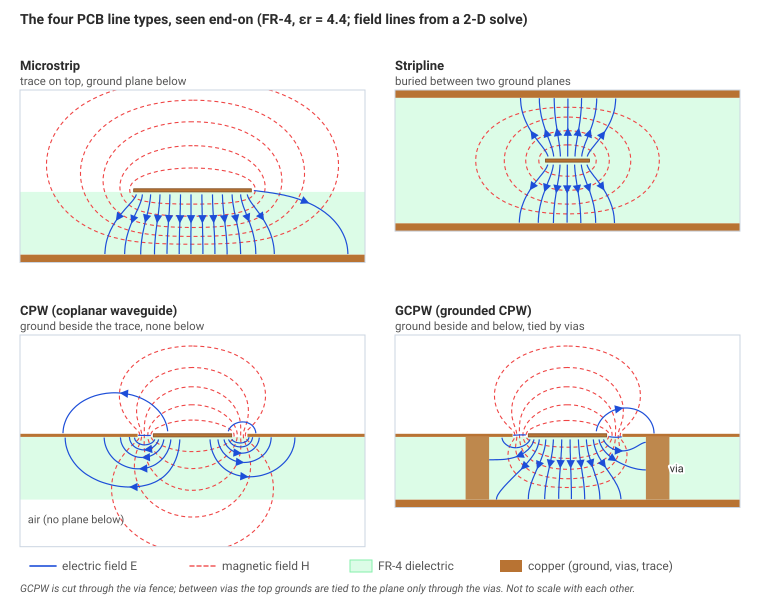
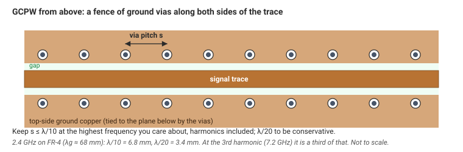
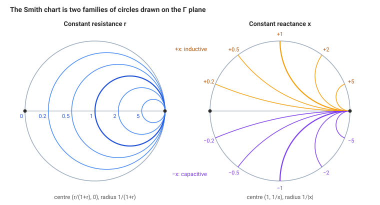
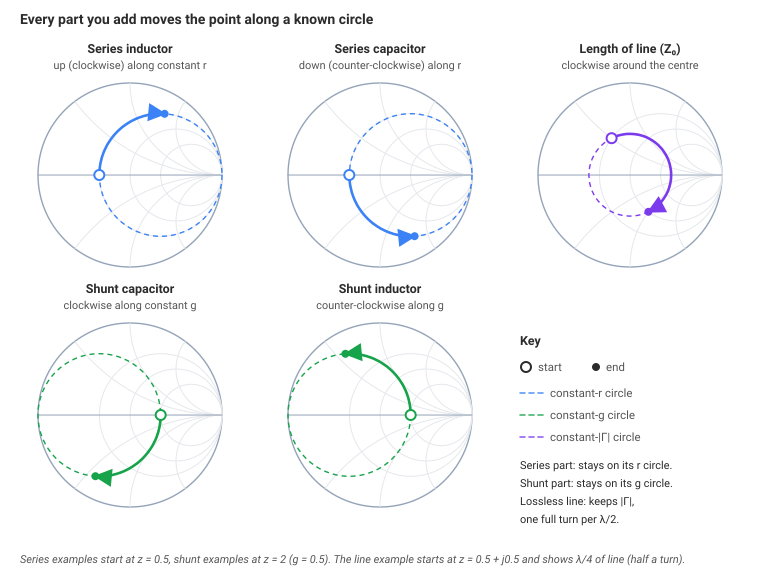
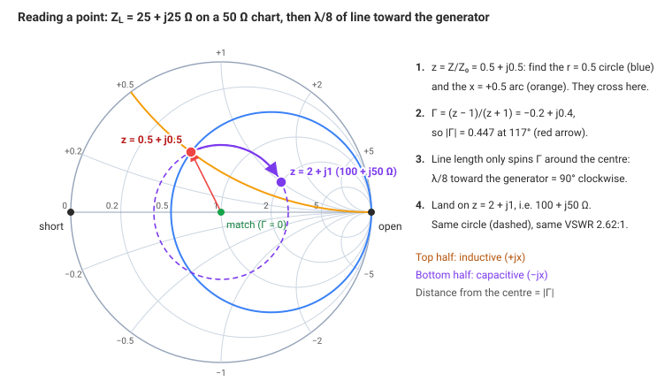
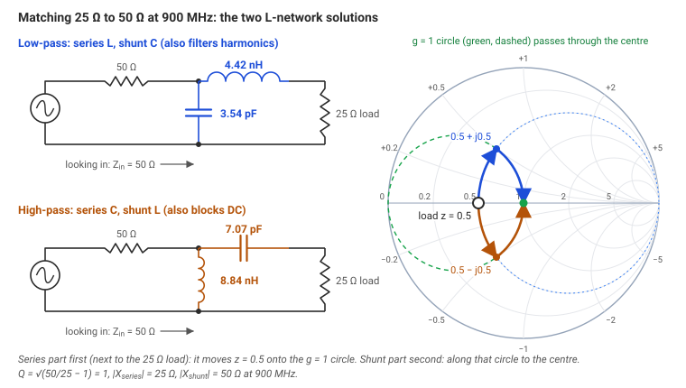
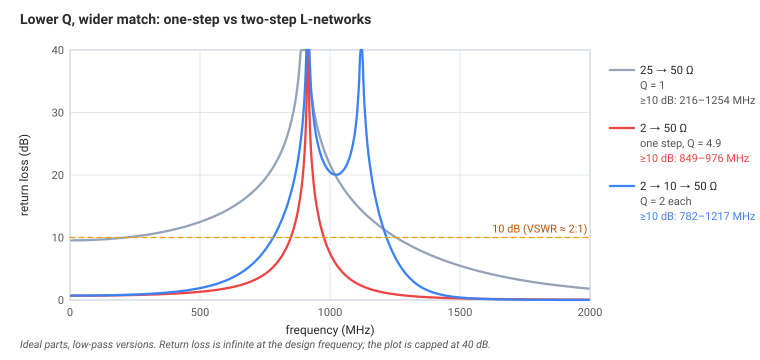
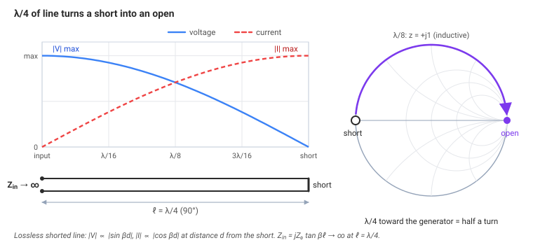
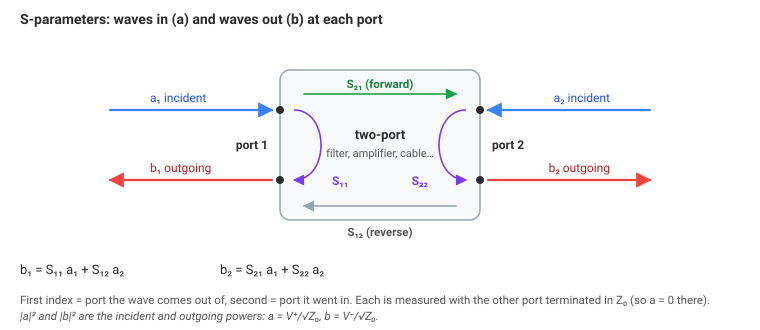
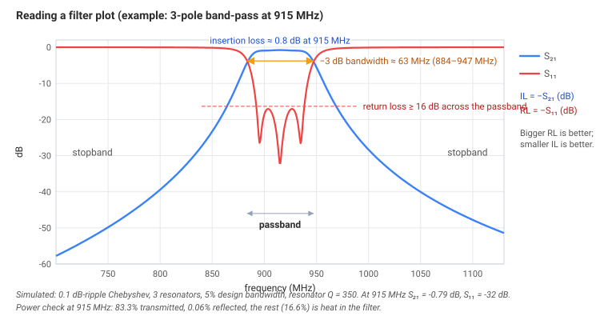

# Module 2: Transmission Lines, Propagation & Matching

> **What you should already know**
> - From [Module 1](../01-fundamentals/): characteristic impedance $$Z_0$$, the reflection coefficient $$\Gamma = (Z_L - Z_0)/(Z_L + Z_0)$$, VSWR and return loss, and electrical length $$\theta = \beta\ell$$.
> - Reactance: an inductor has $$X_L = 2\pi f L$$ (positive), a capacitor has $$X_C = -1/(2\pi f C)$$ (negative).
> - Complex numbers $$a + jb$$: how to add them, and that $$1/(a + jb)$$ is another complex number. The widgets do the arithmetic if you'd rather skip it.

Module 1 was about *finding* reflections. This module is about **controlling** them. You'll learn:

- which kinds of line exist on and off a circuit board, and when to use each;
- how to read and use the **Smith chart**, the map every RF engineer draws on;
- how to **match** any load to 50 Ω with two components, or with a piece of line;
- why a short circuit can look like an open circuit a quarter wave away;
- how to read **S-parameters**, return loss and insertion loss on a datasheet;
- what really limits **bandwidth**.

---

## 1. Propagation modes

### The idea

A **mode** is a particular shape that the electric and magnetic fields can hold while they travel down a structure. Different structures allow different shapes.

- **TEM** (transverse electromagnetic): E and H both point *across* the line, with nothing pointing along it. This is the simplest mode. It needs **two conductors** (signal and return) and works all the way down to DC. Coax and stripline carry TEM.
- **Quasi-TEM:** almost TEM. Microstrip and coplanar lines have part of their field in air and part in the board, so the wave can't be perfectly TEM, but it's close enough that $$Z_0$$ and $$\varepsilon_{\text{eff}}$$ work. The small difference makes $$\varepsilon_{\text{eff}}$$ creep up slightly with frequency (*dispersion*).
- **TE and TM** (transverse electric / transverse magnetic): one of the fields has a component along the direction of travel. These modes live in **hollow waveguides**, a single metal pipe with no center conductor. They only exist above a **cutoff frequency**, where the pipe is big enough for the wave to "fit".

### The math

For a rectangular waveguide with inside width $$a$$ and height $$b$$ (air-filled), each mode has a cutoff frequency:

$$f_{c,mn} = \frac{c}{2}\sqrt{\left(\frac{m}{a}\right)^2 + \left(\frac{n}{b}\right)^2}$$

- $$m, n$$ are whole numbers that count the half-wave field patterns across the width and height.
- The lowest mode is **TE₁₀**: $$f_c = c/(2a)$$. The guide is wide enough once half a wavelength fits across it.

**Worked example: WR-90 waveguide** ($$a = 22.86$$ mm): $$f_c = 3\times10^8 / (2 \times 0.02286) = 6.56$$ GHz. It's used from 8.2 to 12.4 GHz, safely above TE₁₀ cutoff and below the next mode.

TEM lines have no lower cutoff, but they do have an *upper* limit, where the first higher-order mode can appear and the line stops behaving like a simple $$Z_0$$:

- **Coax:** the first extra mode (TE₁₁) appears at about $$f_c \approx \dfrac{c}{\pi\sqrt{\varepsilon_r}\,(D + d)/2}$$. For an SMA connector ($$D \approx 4.2$$ mm, $$d = 1.27$$ mm, PTFE $$\varepsilon_r = 2.05$$) that's about 24 GHz, which is why SMAs are rated to 18–26.5 GHz.
- **Microstrip:** on thick boards, energy can leak into *surface waves* that travel through the dielectric slab. A rough threshold is $$f \approx c/(4h\sqrt{\varepsilon_r - 1})$$: about 25 GHz for 1.6 mm FR-4. That's one reason high-frequency boards use thin dielectrics.

> **Rule:** a line is only a nice, single-mode $$Z_0$$ line between its lower cutoff (none for TEM) and the frequency where the next mode appears. Stay well inside that window.

---

## 2. Microstrip, stripline, CPW and GCPW

### The idea

On a PCB you'll pick from four line types. They differ in **where the fields go**, which decides their loss, how much they radiate, and how easy they are to connect parts to.

{: .figure}

*The four PCB line types seen end-on, with their fields. Microstrip and CPW leave part of the field in the air; stripline keeps it all inside the board; GCPW adds a plane below, tied to the side grounds by vias.*

| | Microstrip | Stripline | CPW | GCPW (grounded CPW) |
|---|---|---|---|---|
| Where it is | top layer, ground below | buried between two grounds | top layer, ground beside it | top layer, ground beside **and** below |
| Mode | quasi-TEM | **true TEM** | quasi-TEM | quasi-TEM |
| $$\varepsilon_{\text{eff}}$$ | between 1 and $$\varepsilon_r$$ | $$= \varepsilon_r$$ | between 1 and $$\varepsilon_r$$ | between 1 and $$\varepsilon_r$$ |
| Radiation / coupling | some | almost none (shielded) | some | low, if the via fence is good |
| Mounting parts | easy | needs vias to reach | easy | easy |
| Typical use | most RF boards | long runs, dense boards, isolation | thin substrates, on-chip, probing | **most modern RF boards**, high isolation |

**Choosing:**

- **Microstrip** when you need to mount parts directly on the line and the frequency is moderate.
- **GCPW** when isolation matters (next to a noisy digital part, or a PA near an LNA), or when the board is thick and a 50 Ω microstrip would be uncomfortably wide. Adding side grounds lets a narrower trace hit 50 Ω.
- **Stripline** for long runs and anywhere you can't afford to radiate. The cost is a via transition (Module 4) at each end.

**Via fences.** In GCPW, the top-side ground strips are tied to the ground plane below with a row of vias. If the vias are too far apart, the space between them can resonate and leak. Keep the spacing **≤ λ/10** at the highest frequency you care about, *including harmonics*. Use **λ/20** if you want to be conservative. At 2.4 GHz on FR-4 ($$\lambda_g \approx 68$$ mm), λ/10 is 6.8 mm and λ/20 is 3.4 mm. For the 3rd harmonic at 7.2 GHz, it's a third of that.

{: .figure}

*A GCPW from above. The via pitch s must stay below λ/10 (λ/20 to be safe) at the highest frequency that matters, harmonics included.*

> **Go deeper: why stripline is "true" TEM.** In stripline every field line is inside one uniform dielectric, so the wave speed is the same everywhere in the cross-section and a pure TEM wave can exist, with $$\varepsilon_{\text{eff}} = \varepsilon_r$$ exactly. In microstrip, the field lines that cross from dielectric to air would have to travel at two speeds at once. The fields adapt by adding a tiny component along the line, which is why it's "quasi"-TEM. You don't usually need to care, except that it makes microstrip slightly dispersive and makes its $$Z_0$$ formulas approximations (Module 1's microstrip calculator uses Hammerstad–Wheeler, accurate to about 1%).

---

## 3. The Smith chart

### The idea

Impedances can be anything: $$0$$ to $$\infty$$ ohms of resistance, $$-\infty$$ to $$+\infty$$ of reactance. That's impossible to draw on a page. The **Smith chart** solves it with a trick: instead of plotting the impedance $$Z$$, plot its **reflection coefficient Γ**. Every passive impedance has $$\lvert \Gamma\rvert  \le 1$$, so *every* load fits inside a circle of radius 1.

Then grid lines are drawn on that circle to show which impedance each point corresponds to. Drag the dot around in the **live Smith chart** (just after this list) while you read it.

- **Center:** $$\Gamma = 0$$, perfectly matched ($$Z = Z_0$$). This is where you want to end up.
- **Left edge:** short circuit. **Right edge:** open circuit.
- **Horizontal line through the middle:** pure resistances, from 0 (left) to ∞ (right).
- **Top half:** inductive ($$+jX$$). **Bottom half:** capacitive ($$-jX$$).
- **Outer rim:** $$\lvert \Gamma\rvert  = 1$$, pure L or C with no resistance.
- **Distance from the center = $$\lvert \Gamma\rvert$$.** A circle around the center is a circle of constant VSWR.



### The math

Everything on the chart is **normalized** to $$Z_0$$:

$$z = \frac{Z}{Z_0} = r + jx \qquad\qquad \Gamma = \frac{z - 1}{z + 1}$$

- $$r$$ is the normalized resistance and $$x$$ the normalized reactance (no units). For $$Z_0 = 50\ \Omega$$, $$Z = 25 + j25\ \Omega$$ becomes $$z = 0.5 + j0.5$$.

The grid is made of two families of circles:

- **Constant-r circles:** center at $$\left(\frac{r}{1+r},\,0\right)$$, radius $$\frac{1}{1+r}$$. They all touch the right edge.
- **Constant-x arcs:** center at $$\left(1,\,\frac{1}{x}\right)$$, radius $$\frac{1}{\lvert x\rvert }$$. Only the part inside the unit circle is drawn.

For **admittance** $$y = 1/z = g + jb$$, the same chart works rotated by 180°, with the green **constant-g** and **constant-b** circles in the Smith chart widget above. Admittance is the natural thing to use for parts connected in **parallel (shunt)**, because parallel admittances simply add.

{: .figure}

*The Smith chart grid is two families of circles: constant r (left) and constant x (right). Overlay them and every point has an r and an x.*

### Moving on the chart

Each thing you add to a circuit moves the point in a predictable way. This is what makes the chart a design tool rather than just a plot:

| What you add | How the point moves |
|---|---|
| a **series inductor** | clockwise along its constant-r circle (upward) |
| a **series capacitor** | counter-clockwise along its constant-r circle (downward) |
| a **shunt capacitor** | clockwise along its constant-g circle |
| a **shunt inductor** | counter-clockwise along its constant-g circle |
| a length of **line** ($$Z_0$$ = chart's $$Z_0$$) | clockwise around the **center**, at constant $$\lvert \Gamma\rvert$$ |

{: .figure}

*How each part moves the point: series parts along constant-r circles, shunt parts along constant-g circles, line length around the centre.*

Moving along a line toward the source (the "generator") rotates Γ by $$-2\beta\ell$$:

$$\Gamma_{\text{in}} = \Gamma_L\,e^{-j2\beta\ell}$$

so **one full turn is λ/2 of line**, and a quarter wave (λ/4) is half a turn. In the Smith chart widget above, slide "line length" and watch the purple dot circle the center at a fixed radius: a lossless line never changes VSWR, only *where on the circle* you are.

**Worked example: reading a point.** A load $$Z_L = 25 + j25\ \Omega$$ on a 50 Ω chart:

1. $$z = 0.5 + j0.5$$. Find the r = 0.5 circle and the x = +0.5 arc. They cross in the upper left.
2. $$\Gamma = (z-1)/(z+1) = (-0.5 + j0.5)/(1.5 + j0.5) = -0.2 + j0.4$$, so $$\lvert \Gamma\rvert  = 0.447$$ at 117°.
3. Add λ/8 of 50 Ω line. That rotates Γ by $$2 \times 45^\circ = 90^\circ$$ clockwise, to 27°. The chart (or the formula in section 5) gives $$Z_{\text{in}} = 100 + j50\ \Omega$$. Same VSWR (2.62:1), very different impedance.

{: .figure}

*The worked example on the chart: 25 + j25 Ω sits at Γ = 0.447∠117°. λ/8 of line spins it 90° clockwise to 100 + j50 Ω, on the same VSWR circle.*

---

## 4. Lumped-element matching

### The idea

A matching network is a small circuit, usually inductors and capacitors, placed between the source and the load so that the source sees exactly $$Z_0$$. Inductors and capacitors don't absorb power (ideally), so all the power that would have been reflected now goes into the load instead.

The simplest network that can match *any* resistance to any other is the **L-network**: one part in series and one part in shunt. On the Smith chart it's a two-step trip from the load to the center:

1. one move along a circle with a series part (or a shunt part), to reach the one circle that passes through the center;
2. a second move along that circle, with the other kind of part, to land on the center.

For any load there are usually **two** L-networks that work: one **low-pass** (series L, shunt C, which also helps filter harmonics) and one **high-pass** (series C, shunt L, which also blocks DC). The **L-network designer** widget (after the worked example) finds all of them and draws their paths.

### The math (real-to-real match)

To match a low resistance $$R_{\text{low}}$$ to a high resistance $$R_{\text{high}}$$:

$$Q = \sqrt{\frac{R_{\text{high}}}{R_{\text{low}}} - 1} \qquad\quad |X_{\text{series}}| = Q\,R_{\text{low}} \qquad\quad |X_{\text{shunt}}| = \frac{R_{\text{high}}}{Q}$$

- $$Q$$ is the network's **node Q** (no units). It's set by the impedance ratio, not by you.
- The **series** part goes on the **low-resistance** side, and the **shunt** part on the **high-resistance** side.
- Turn reactances into parts: $$L = X/(2\pi f)$$ and $$C = 1/(2\pi f\,\lvert X\rvert )$$.

**Worked example: match a 25 Ω load to a 50 Ω source at 900 MHz.**

1. $$Q = \sqrt{50/25 - 1} = 1$$
2. $$\lvert X_{\text{series}}\rvert  = 1 \times 25 = 25\ \Omega$$, next to the 25 Ω load.
3. $$\lvert X_{\text{shunt}}\rvert  = 50/1 = 50\ \Omega$$, on the 50 Ω source side.
4. **Low-pass version:** series $$L = 25/(2\pi \times 900\times10^6) = 4.42$$ nH, shunt $$C = 1/(2\pi \times 900\times10^6 \times 50) = 3.54$$ pF.
5. **High-pass version:** series $$C = 1/(2\pi \times 900\times10^6 \times 25) = 7.07$$ pF, shunt $$L = 50/(2\pi \times 900\times10^6) = 8.84$$ nH.
6. Check the low-pass one: $$25 + j25$$ in parallel with $$-j50$$ gives exactly 50 Ω.

{: .figure}

*Both solutions of the worked example. The series part (next to the load) moves z = 0.5 up or down onto the g = 1 circle; the shunt part slides along it to the center.*

**Complex loads.** If the load has its own reactance, such as an antenna at $$10 + j30\ \Omega$$, you can either cancel the reactance first and then match the resistance, or let the two steps absorb it. The widget solves the general case exactly (it uses the closed-form solution in Pozar's *Microwave Engineering*, §5.1). Real chip inductors and capacitors are not ideal, so you always tune on the bench with a VNA (Module 5).



### Bandwidth and Q

A match is perfect at only one frequency. Away from it, the inductor's reactance grows and the capacitor's shrinks, and the match drifts. **The higher the Q, the faster it drifts.** Roughly, the fractional bandwidth is about $$1/Q$$ or a little less (for a 10 dB return-loss band).

| Match (low-pass versions) | Design frequency | Q | Return loss ≥ 10 dB from | Bandwidth |
|---|---|---|---|---|
| 25 Ω → 50 Ω, one L-network | 900 MHz | 1.0 | 216–1254 MHz | > 100% |
| 2 Ω → 50 Ω, one L-network | 915 MHz | 4.9 | 849–976 MHz | 14% |
| 2 Ω → 10 Ω → 50 Ω, two L-networks | 915 MHz | 2 each | 782–1217 MHz | 48% |

{: .figure}

*The three rows of the table as return-loss curves. Splitting a big ratio into two low-Q steps widens the 10 dB band from 849–976 MHz to 782–1217 MHz.*

The last row shows the standard trick: for big impedance ratios (like a power amplifier's output), **match in steps**. Each step has a lower Q, so the whole thing is much wider. The best intermediate resistance is the geometric mean, $$\sqrt{2 \times 50} = 10\ \Omega$$.

**π and T networks** add a third part. That lets you choose the Q yourself, higher than the L-network's minimum. That's useful when you *want* a narrow response to filter out harmonics, as in a PA output.

> **Go deeper: why "node Q"?** At the point between the two parts, the circuit looks like a resistance $$R$$ with a reactance $$X$$ in series (or a conductance with a susceptance in shunt). The ratio $$\lvert X\rvert /R$$ at that node is exactly the Q of the L-network, and on the Smith chart it's the constant-Q curve that the path crosses. Lines of constant Q on the chart are arcs through the open and short points. Staying close to the horizontal axis, at low Q, is what gives wide bandwidth.

---

## 5. Input impedance and quarter-wave transformers

### The idea

A piece of transmission line *transforms* impedance. What the source sees at the input depends on the load and on the line's electrical length. This is the most surprising consequence of signals being waves:

> **A short circuit, seen through a quarter wavelength of line, looks like an open circuit.**

Here's why. The wave travels λ/4 to the short (90° of delay), flips sign at the short (180°), and travels λ/4 back (another 90°). Total: 360°. The reflection arrives back at the input **exactly in step** with the outgoing wave, so the voltages add (maximum voltage) and the currents cancel (zero current). Big voltage and no current is what an open circuit looks like.

The same trick works the other way: an open, seen through λ/4, looks like a short. And in between, a shorted line looks like an inductor or a capacitor depending on its length. On the Smith chart it's just half a turn: from the left edge to the right edge.

{: .figure}

*A shorted λ/4 line: zero voltage and maximum current at the short become maximum voltage and zero current at the input. That is an open circuit.*

### The math

The input impedance of a lossless line of length ℓ, characteristic impedance $$Z_0$$, ending in a load $$Z_L$$:

$$Z_{\text{in}} = Z_0\,\frac{Z_L + jZ_0\tan\beta\ell}{Z_0 + jZ_L\tan\beta\ell}$$

- $$\beta\ell = 2\pi\ell/\lambda_g$$ is the electrical length in radians.

Special cases that follow from it:

| Line | $$Z_{\text{in}}$$ | Notes |
|---|---|---|
| any length, matched load ($$Z_L = Z_0$$) | $$Z_0$$ | a matched line is invisible |
| λ/2 | $$Z_L$$ | repeats the load every half wave |
| λ/4 | $$Z_0^2 / Z_L$$ | **inverts** the load |
| shorted, length ℓ | $$jZ_0\tan\beta\ell$$ | inductive below λ/4, capacitive between λ/4 and λ/2 |
| open, length ℓ | $$-jZ_0\cot\beta\ell$$ | capacitive below λ/4 |

**Quarter-wave transformer.** Because a λ/4 line gives $$Z_{\text{in}} = Z_1^2/Z_L$$, you can match a resistance $$R_L$$ to $$Z_0$$ with a λ/4 section of impedance

$$Z_1 = \sqrt{Z_0\,R_L}$$

**Worked example: match 100 Ω to 50 Ω at 915 MHz on 1.6 mm FR-4.**

1. $$Z_1 = \sqrt{50 \times 100} = 70.7\ \Omega$$
2. A 70.7 Ω microstrip on 1.6 mm FR-4 ($$\varepsilon_r = 4.4$$) is about 1.6 mm wide, with $$\varepsilon_{\text{eff}} \approx 3.17$$.
3. Length: $$\lambda_g/4 = \dfrac{3\times10^8}{915\times10^6\sqrt{3.17}}/4 = 46$$ mm.
4. Check: $$Z_{\text{in}} = 70.7^2/100 = 50\ \Omega$$. ✓

With the **quarter-wave transformer** widget below you can see the trade: a single section gives return loss ≥ 20 dB over 37% bandwidth for 100 Ω → 50 Ω. A two-section *binomial* transformer (59.5 Ω then 84.1 Ω) widens that to about 72%, at the cost of twice the length.



**Where you'll see this:**

- **Stubs:** a short piece of shorted or open line in shunt acts as an L or C. Handy at high frequencies, where chip parts misbehave.
- **Bias tees:** a λ/4 high-impedance line from an RF-grounded point (a big capacitor to ground) looks *open* at the RF frequency. DC bias passes through, and RF doesn't notice it's there.
- **DC grounding an antenna:** a shorted λ/4 stub grounds the antenna for ESD and DC, but looks open to the RF signal.
- **Power dividers** (the Wilkinson, Module 3) and **baluns** are built from λ/4 sections.

> These tricks are **narrowband**. A line that's λ/4 at 915 MHz is λ/2 at 1830 MHz, where a shorted stub looks like a short again. Always check what your stubs do at the harmonics.

---

## 6. S-parameters

### The idea

How do you describe a filter, an amplifier or a cable completely, without knowing what's inside? You treat it as a box with **ports** (connections). At each port you send in a wave and measure what comes back out of every port. The set of ratios is the **scattering parameters**, or S-parameters. They're what a VNA measures and what every RF datasheet gives you.

For a two-port (in and out):

| | Meaning | Plain language |
|---|---|---|
| $$S_{11}$$ | reflected at port 1 ÷ incident at port 1 | input match (this is Γ at the input) |
| $$S_{21}$$ | out of port 2 ÷ incident at port 1 | forward gain or loss |
| $$S_{12}$$ | out of port 1 ÷ incident at port 2 | reverse leakage (isolation) |
| $$S_{22}$$ | reflected at port 2 ÷ incident at port 2 | output match |

The first number is where the wave comes **out**, the second is where it went **in**. Every measurement assumes the other port is terminated in a matched $$Z_0$$ load, so nothing comes back in from that side.

{: .figure}

*S-parameters relate the waves leaving each port (b) to the waves arriving (a).*

### The math

Define incident and outgoing **power waves** at each port, $$a_n$$ and $$b_n$$, scaled so that $$\lvert a_n\rvert ^2$$ is the incident power and $$\lvert b_n\rvert ^2$$ the outgoing power ($$a = V^+/\sqrt{Z_0}$$, $$b = V^-/\sqrt{Z_0}$$). Then

$$\begin{pmatrix} b_1 \\ b_2 \end{pmatrix} = \begin{pmatrix} S_{11} & S_{12} \\ S_{21} & S_{22} \end{pmatrix}\begin{pmatrix} a_1 \\ a_2 \end{pmatrix}, \qquad S_{11} = \left.\frac{b_1}{a_1}\right|_{a_2 = 0}, \quad S_{21} = \left.\frac{b_2}{a_1}\right|_{a_2 = 0}$$

Two properties tell you a lot at a glance:

- **Reciprocal** ($$S_{21} = S_{12}$$): true for any passive device made of ordinary materials, such as cables, filters, attenuators and antennas. Amplifiers aren't reciprocal (they're designed so that $$S_{12} \ll S_{21}$$), and neither are circulators and isolators (Module 3).
- **Lossless** ($$\lvert S_{11}\rvert ^2 + \lvert S_{21}\rvert ^2 = 1$$): all the power is either reflected or transmitted. For a real part, whatever is missing was turned into heat (or radiated).

**Worked example: what a filter datasheet tells you.** At 915 MHz, $$S_{11} = -15$$ dB and $$S_{21} = -0.8$$ dB.

1. Reflected: $$\lvert S_{11}\rvert ^2 = 10^{-15/10} = 0.032$$ (3.2%)
2. Transmitted: $$\lvert S_{21}\rvert ^2 = 10^{-0.8/10} = 0.832$$ (83.2%)
3. Lost inside: $$1 - 0.032 - 0.832 = 0.137$$ (13.7%). That much becomes heat in the filter.

The **S-parameter power** widget below does this check for any pair of numbers, and flags combinations a passive part can't produce.



Datasheets give S-parameters as plots and as **Touchstone files** (`.s2p`), which simulators read directly. Always note the **reference impedance** (almost always 50 Ω) and where the **reference planes** are: the measurement includes everything between the planes, such as pads and connectors.

---

## 7. Return loss and insertion loss

### The math

$$\text{RL} = -20\log_{10}|S_{11}|\ \ \text{dB} \qquad\qquad \text{IL} = -20\log_{10}|S_{21}|\ \ \text{dB}$$

- **Return loss (RL):** how much weaker the reflection is than the incident wave. **Bigger is better.** 10 dB is acceptable for an antenna, 15–20 dB is good for a filter or connector.
- **Insertion loss (IL):** how much the signal drops passing through. **Smaller is better.** A good SMA cable at 1 GHz: a few tenths of a dB. A SAW filter: 1–3 dB.

Both are positive numbers, while the plotted S-parameters are negative in dB. The same −0.8 dB on an $$S_{21}$$ plot is "0.8 dB of insertion loss".

### Reading a filter plot

- **Passband:** where $$S_{21}$$ is near 0 dB. The signal gets through.
- **Stopband:** where $$S_{21}$$ is very negative. Unwanted signals are blocked.
- **Ripple:** small wiggles in the passband, from reflections bouncing between the filter's internal sections (Module 1, section 5).
- **−3 dB bandwidth:** the range where $$S_{21}$$ is within 3 dB of its best value, so at least half the power gets through.
- Look at $$S_{11}$$ in the passband too. A filter that loses little in $$S_{21}$$ but has poor $$S_{11}$$ will upset whatever drives it.

{: .figure}

*A simulated 915 MHz band-pass filter. Insertion loss is −S₂₁ in the passband, return loss is −S₁₁, and the −3 dB points set the bandwidth.*

---

## 8. Bandwidth

### The idea

**Bandwidth** is the range of frequencies over which something works well enough. "Well enough" has to be stated, so there are several definitions:

- **3 dB bandwidth:** where the response is within 3 dB (half power) of its peak. Used for filters, amplifiers and resonators.
- **10 dB return-loss bandwidth** (VSWR < 2:1): used for antennas and matching networks.
- **Fractional bandwidth:** bandwidth divided by center frequency, $$\Delta f/f_0$$. A 26 MHz band at 915 MHz is 2.8%, which is "narrowband". 2–18 GHz is 160%, which is "broadband".

### The math: Q and bandwidth

The **quality factor** Q measures how much energy a resonant circuit stores compared with how much it loses:

$$Q = 2\pi\,\frac{\text{energy stored}}{\text{energy lost per cycle}}$$

A high-Q circuit stores a lot and loses little, so it rings for many cycles and responds only near its resonant frequency. For a simple resonator:

$$Q = \frac{f_0}{\Delta f_{3\,\text{dB}}}$$

**Worked example:** a resonator with Q = 50 at 915 MHz has a 3 dB bandwidth of $$915/50 = 18.3$$ MHz.

This is the same Q as the matching network's in section 4: a higher-Q match stores more energy in its L and C relative to what it delivers to the load each cycle, so it's narrower.

**System bandwidth: the narrowest part wins.** A receive chain with an antenna good from 880 to 960 MHz, a matching network good from 850 to 990 MHz and a filter passing 902–928 MHz has a system bandwidth of 902–928 MHz. Improving the antenna's bandwidth won't widen the system. Find the narrowest element first.

> **Go deeper: the Bode–Fano limit.** There's a hard physical limit on how well you can match a reactive load. For a load that's a resistance R in parallel with a capacitance C, *any* lossless matching network obeys
> $$\int_0^{\infty} \ln\frac{1}{|\Gamma(\omega)|}\,d\omega \;\le\; \frac{\pi}{RC}$$
> You have a fixed "budget" of match. You can spend it as a deep match over a narrow band or a shallow match over a wide band, but not both. For example, with R = 50 Ω and C = 2 pF, the best possible flat 20 dB return loss ($$\lvert \Gamma\rvert  = 0.1$$) can cover at most $$\Delta f = \frac{\pi/(RC)}{2\pi\,\ln 10} \approx 2.2$$ GHz, no matter how clever the network. This is why small antennas (which look like a large reactance) are always narrowband.

---

## Key takeaways

- **Modes:** coax and stripline carry true TEM; microstrip and CPW carry quasi-TEM; waveguides carry TE/TM above a cutoff ($$f_c = c/2a$$ for TE₁₀). Every line has an upper limit where extra modes appear.
- **Pick the line for the job:** microstrip for simplicity, GCPW for isolation (via fence spacing ≤ λ/10, λ/20 to be safe), stripline for shielding.
- The **Smith chart** plots Γ with impedance grid lines on top. Center = matched. Series parts move along r-circles, shunt parts along g-circles, line length rotates around the center (λ/2 per turn).
- An **L-network** matches any two resistances with one series and one shunt part: $$Q = \sqrt{R_{\text{high}}/R_{\text{low}} - 1}$$. Large ratios → high Q → narrow bandwidth → match in steps.
- A **λ/4 line inverts impedance**: $$Z_{\text{in}} = Z_0^2/Z_L$$. A short becomes an open. A λ/4 transformer of $$\sqrt{Z_0 R_L}$$ matches $$R_L$$.
- **S-parameters:** $$S_{11}$$ = input match, $$S_{21}$$ = gain or loss. For a passive part, whatever isn't reflected or transmitted is lost as heat.
- **RL** = −20 log\|S₁₁\| (bigger is better), **IL** = −20 log\|S₂₁\| (smaller is better).
- **Q = 2π × stored / lost per cycle = f₀/Δf.** The narrowest element sets the system bandwidth, and Bode–Fano limits how wide any match can be.

## Interactive

All four widgets are embedded in the sections above. Open them full screen here:

- **[Live Smith chart](widgets/demo.html?w=smith-chart):** drag the load or use the R/X sliders; add line length toward the generator; toggle the admittance grid; switch $$Z_0$$ between 50 and 75 Ω. Readouts for z, Γ, VSWR, return loss, $$Z_{\text{in}}$$ and $$Y_{\text{in}}$$. A one-click animation shows a short turning into an open over λ/4.
- **[L-network designer](widgets/demo.html?w=l-match-designer):** enter the source resistance, load R + jX and frequency. It lists every L-network solution with part values, node Q and 10 dB bandwidth, draws each path on a Smith chart, and plots return loss against frequency.
- **[Quarter-wave transformer](widgets/demo.html?w=quarter-wave-transformer):** choose the load and design frequency; compare no match, one λ/4 section and a two-section binomial transformer over 0–3 f₀, with the physical λ/4 length on your board.
- **[S-parameter power check](widgets/demo.html?w=s-parameter-power):** set $$S_{11}$$ and $$S_{21}$$ and see how the power splits into reflected, transmitted and lost.

## Practical

*Placeholder: YJSP practicals for this module will go here (for example, designing and tuning the matching network for a real antenna, measured on a VNA before and after). Examples to be provided.*

## Check yourself

Answers are hidden. Try each one before you open it.

### Easy

1. **Recall.** Where on the Smith chart are a short, an open and a matched load?
   

Answer
Short: left edge (Γ = −1). Open: right edge (Γ = +1). Matched: the center (Γ = 0).

2. **Recall.** What's the input impedance of a λ/2 line ending in a 30 Ω load? Of a λ/4 line (Z₀ = 50 Ω) ending in a short?
   

Answer
λ/2: the load repeats, so 30 Ω. λ/4 shorted: Z₀²/0 → ∞, an open circuit.

3. **Read.** A datasheet shows $$S_{21} = -1.2$$ dB and $$S_{11} = -18$$ dB. What are the insertion loss and the return loss?
   

Answer
IL = 1.2 dB, RL = 18 dB.

### Medium

4. **Design.** Design a low-pass L-network to match a 12.5 Ω load to 50 Ω at 433 MHz. Which part goes next to the load?
   

Answer
Q = √(50/12.5 − 1) = √3 = 1.73. Series X = 1.73 × 12.5 = 21.7 Ω next to the load: L = 21.7/(2π × 433×10⁶) = 7.96 nH. Shunt X = 50/1.73 = 28.9 Ω on the 50 Ω side: C = 1/(2π × 433×10⁶ × 28.9) = 12.7 pF. The series part goes next to the low-resistance load.

5. **Design.** What impedance and length of line match a 200 Ω load to 50 Ω at 2.4 GHz on a board with $$\varepsilon_{\text{eff}} = 3.0$$?
   

Answer
Z₁ = √(50 × 200) = 100 Ω. λ_g = 3×10⁸/(2.4×10⁹ × √3) = 72.2 mm, so the line is 18.0 mm long.

6. **Smith chart.** You add series inductance to a load at $$z = 1 - j1$$. Which way does the point move, and where does it end up if you add exactly $$x = +1$$?
   

Answer
Clockwise (upward) along the r = 1 circle, ending at z = 1 + j0: the center. Perfectly matched with one series inductor.

7. **Power.** An amplifier has $$S_{21} = +15$$ dB and $$S_{12} = -25$$ dB. Is it reciprocal? How much of a signal entering the output leaks back out of the input?
   

Answer
No: S₂₁ ≠ S₁₂. The reverse leakage is −25 dB, so 10^(−2.5) = 0.32% of the power.

### Hard

8. **Explain.** Using waves (not the formula), explain why an open circuit seen through λ/4 of line looks like a short.
   

Answer
The wave travels λ/4 out (90°), reflects from the open with no sign flip (0°), and travels λ/4 back (90°): 180° in total. The returning wave arrives exactly opposite to the outgoing one, so the voltages cancel (zero voltage) while the currents add. Zero voltage with current flowing is a short circuit.

9. **Bandwidth.** You must match a 3 Ω PA output to 50 Ω at 915 MHz, and you need return loss ≥ 10 dB from 902 to 928 MHz with lots of margin. Compare a single L-network with a two-step match. What intermediate resistance would you choose? (Check your answer in the [L-network designer](widgets/demo.html?w=l-match-designer).)
   

Answer
Single L: Q = √(50/3 − 1) = 3.96. The 10 dB return-loss band comes out about 17% wide (roughly 830–990 MHz for the low-pass version). That covers 902–928 MHz, but a few percent of part tolerance or a PA impedance that shifts with power eats much of the margin. Two steps through √(3 × 50) = 12.2 Ω: each step has Q = √(12.2/3 − 1) ≈ 1.75, and the band widens to about 56% (roughly 765–1280 MHz). It's much more tolerance-proof, at the cost of two more parts.

10. **Limits.** A friend claims that a clever enough matching network can give their tiny antenna 30 dB return loss from 400 MHz to 6 GHz. What principle says they're wrong, and what tradeoff does it force?
    

Answer
The Bode–Fano limit. A small antenna looks like a resistance with a large reactance, and the integral of ln(1/|Γ|) over frequency is capped by that reactance. A deep match (30 dB) can only cover a narrow band, and a wide band only allows a shallow match. They have to trade depth of match for bandwidth (or make the antenna bigger).

## Design challenges

Each widget ends with a design card. The briefs below give the targets. The live check, a hint, the worked answer and a reference preset are in the widget.

- [A line that makes the antenna look resistive]({{ '/rf/02-lines-and-matching/widgets/demo.html?w=smith-chart' | relative_url }}#dc-smith-chart) ([in the lesson](#3-the-smith-chart)). Find the shortest line that turns a 30 + j40 Ω antenna into a pure resistance that a buildable λ/4 transformer can then match.
- [Match a 915 MHz chip antenna with real parts]({{ '/rf/02-lines-and-matching/widgets/demo.html?w=l-match-designer' | relative_url }}#dc-l-match-designer) ([in the lesson](#4-lumped-element-matching)). Match 18 − j22 Ω to 50 Ω with E12 parts, ≥ 15 dB return loss across 902–928 MHz, and a topology that keeps harmonics down.
- [One section or two?]({{ '/rf/02-lines-and-matching/widgets/demo.html?w=quarter-wave-transformer' | relative_url }}#dc-quarter-wave-transformer) ([in the lesson](#5-input-impedance-and-quarter-wave-transformers)). Match 12.5 Ω to 50 Ω across 2.2–2.7 GHz at 20 dB return loss with the fewest λ/4 sections, and give their widths and lengths on RO4350B.
- [Pick a harmonic filter from its S-parameters]({{ '/rf/02-lines-and-matching/widgets/demo.html?w=s-parameter-power' | relative_url }}#dc-s-parameter-power) ([in the lesson](#6-s-parameters)). Turn reflected-power, delivered-power and heat limits at 1 W into S11/S21 specs and choose between three candidates.
